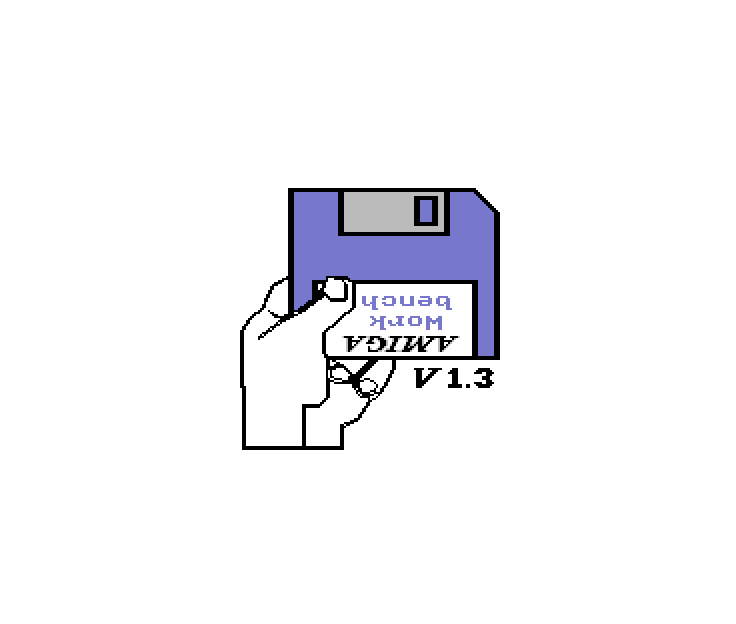
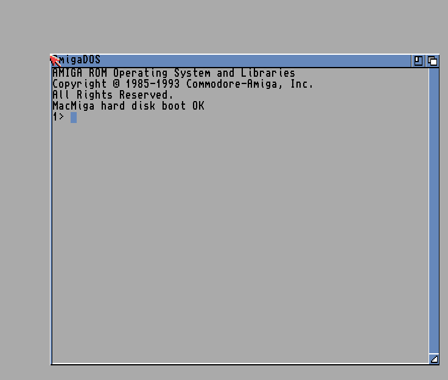
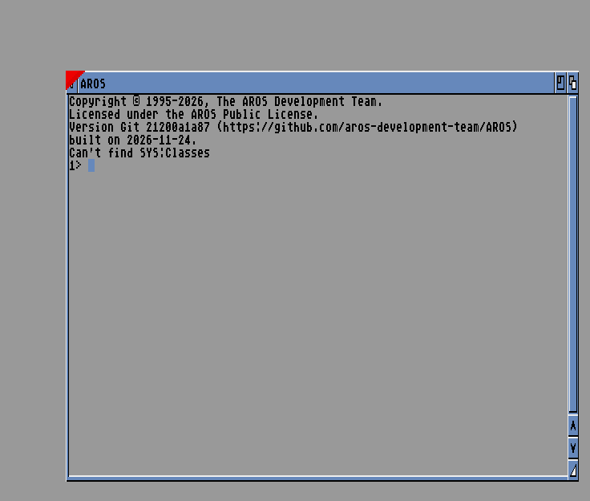

# MacMiga

A Commodore Amiga 500 emulator for macOS, written in Swift. MacMiga is open
source under the [MIT License](LICENSE) and a work in progress. There is no
release to download yet: build it from source, see "Build from source" below.

<table>
  <tr>
    <td width="50%"></td>
    <td width="50%"></td>
  </tr>
  <tr>
    <td align="center">The MacMiga window, Kickstart 3.1 waiting for a disk</td>
    <td align="center">Kickstart 1.3 waiting for a disk</td>
  </tr>
  <tr>
    <td width="50%"></td>
    <td width="50%"></td>
  </tr>
  <tr>
    <td align="center">Kickstart 3.1 booted from a hard disk image</td>
    <td align="center">AROS, started from its boot floppy</td>
  </tr>
</table>

The first picture is a capture of the app's window. The other three are frames
written by the emulator itself (`KickstartProbe --frames`, see "Local Kickstart
startup probe"), with each line doubled as the app's window shows them.

## Status

**Current milestone: booting from ADF floppy images.** Both local Kickstart
ROMs draw their insert-disk screens and boot a bootblock from an ADF disk image,
which then reads further sectors through trackdisk.device. Paula audio is
emulated and played through the Mac's default output. The `MacMiga` app shows
the emulated display in a window and forwards the Mac keyboard and mouse. Booting real AmigaOS
Workbench disks has not been tested.

**AROS:** the boot floppy of AROS, the free AmigaOS-compatible system, starts
under Kickstart 3.1, restarts the machine into AROS's own ROM image, and reaches
the AROS shell on an Intuition screen. See "AROS".

**Hard disk:** a hard disk image (`.hdf`) can be attached: either a hardfile
(one AmigaDOS partition, mounted as `DH0`) or a partitioned image with a Rigid
Disk Block, whose partitions are all mounted under their own names. Kickstart 3.1 and 1.3 both boot from it and run its
`S/Startup-Sequence`; see "Expansion boards and hard disk" below. A hardfile
can be made from a Mac folder or an LHA archive (see "Making a hard disk"); a
game made that way from an LHA archive started from the hard disk under
Kickstart 3.1. WHDLoad 20.1 runs from such a disk with Kickstart 3.1 and fast
RAM; one install (Pac-Man) has been tried. See "WHDLoad".

## Requirements

- macOS 13 or newer.
- A Swift 6 toolchain: Xcode 16 or newer, or a toolchain from swift.org. The
  last build was made with Swift 6.4.2 on macOS 27.2 (Apple silicon).
- A Kickstart ROM image, which is not included: a raw, unencrypted file of
  256 KiB or 512 KiB. Kickstart 1.3 and Kickstart 3.1 (A500/A600/A2000) are the
  two that have been run.

## Build from source

```sh
git clone https://github.com/AgentiLoop/MacMiga.git
cd MacMiga
swift build -c release
```

The package needs nothing from outside this repository (the 68000 core is the
local package `Packages/M68K`). The build puts three programs in
`.build/release`: `MacMiga`, the app, and the command-line tools `MakeHardfile`
(see "Making a hard disk") and `KickstartProbe` (see "Local Kickstart startup
probe").

## Run the app

```sh
swift run -c release MacMiga path/to/kickstart.rom [disk.adf] [disk.hdf]
```

The examples in this README keep the ROMs in a folder named `Kickstart ROMs`
inside the repository. Git ignores ROM, ADF and HDF files, so they stay out of
commits.

A `.hdf` argument, or Machine ▸ Attach Hard Disk (DH0)… (⌘D), attaches a
hardfile and restarts the machine; Detach Hard Disk removes it. Blocks the
Amiga writes are saved back into the file about once a second and on quit (a
file that is not writable is attached write-protected). Machine ▸ New Hard Disk
from Folder or LHA… asks for a folder or archive and for where to save the new
`.hdf`, builds it and attaches it. Machine ▸ 8 MB Fast RAM
adds a Zorro II memory board (off by default, remembered, restarts the machine).
Machine ▸ 1 MB Chip RAM (ECS Agnus) doubles chip RAM and swaps the Agnus (same
rules; see "Chip RAM and the ECS Agnus").

With no arguments it reuses the last ROM, or `Kickstart ROMs/kickstart-1.3.rom`
in the current folder, or asks for one. The Machine menu opens a Kickstart ROM
(⌘K), inserts (⌘O) or ejects (⌘E) a DF0 ADF, and resets (⌘R). The window shows
the full 736×312 frame doubled vertically, emulating one frame per 1/50 s timer
tick on the main thread. Keys map by US-layout position to Amiga raw codes
(Command → Amiga keys, Option → Alt, Page Up/Help → Help); Command-key shortcuts
go to the menu instead, so the Amiga keys only work as plain modifiers. A click
in the window captures the Mac pointer for the Amiga mouse, and pressing ⌘
gives it back. The joystick in port 2 is on the numeric keypad (8/2/4/6 steer,
7/9/1/3 are the diagonals, 0, 5 and Enter fire) and right Option also fires;
Machine ▸ Arrow Keys Control Joystick (Port 2) (⌘J) puts it on the arrow keys,
and a game controller steers it too. Audio plays through AVAudioEngine at the output
device's sample rate with at most ~100 ms queued; silence is inserted when the
emulator falls behind. Verified on November 25, 2026 by launching it
with Kickstart 3.1 and screen-capturing the window, which showed the
insert-disk screen; keyboard and mouse input in the app were not tested by hand.

## Test

```sh
swift test
swift test --package-path Packages/M68K
```

`swift test` runs the tests of the Amiga machine and the second command those
of the CPU package; add `-c release` to either for a release build (see
"Tests"). The library product is `MacMigaCore`. The 68000 core is a separate package,
`Packages/M68K`, with no Amiga code in it (see "CPU package"). Tests use generated byte arrays rather
than proprietary firmware. No Kickstart ROMs or disk images are included.
Supply your own authorized, raw, unencrypted ROM when integrating the core.

## Implemented subset

`Sources/MacMigaCore/AmigaMemory.swift` provides:

- 512 KiB zero-initialized chip RAM at `$000000`–`$07FFFF`, repeated through
  `$1FFFFF` (the chip-RAM space Gary routes to Agnus). `chipRAMSize:` can make
  it 1 MiB or 2 MiB instead; see "Chip RAM and the ECS Agnus".
- 512 KiB slow RAM at `$C00000`–`$C7FFFF` by default (A500 + A501 trapdoor
  expansion; `slowRAMSize: 0` gives a stock 512 KiB machine). The rest of
  `$C00000`–`$D7FFFF` mirrors the custom chip registers, which Kickstart detects
  by writing INTENA through it.
- The Zorro II autoconfig window at `$E80000`. With no expansion boards (the
  default) it is empty: reads return 0 and writes are ignored. Optional boards
  are described under "Expansion boards and hard disk".
- A 512 KiB ROM window at `$F80000`–`$FFFFFF`, accepting 256 KiB images
  mirrored within that window or a full 512 KiB image.
- A power-on ROM overlay over the first 512 KiB only, controlled by CIA-A PA0 (OVL,
  pulled up while PA0 is an input). Writes to ROM-selected addresses are ignored.
- Both CIAs (`CIA8520.swift`) decoded across `$A00000`–`$BFFFFF`: CIA-A on odd
  bytes when A12 is low, CIA-B on even bytes when A13 is low, register from
  A8–A11. Ports with data direction, timers A/B (latch, one-shot/continuous,
  force load, high-byte start in one-shot, B counting A underflows), 24-bit TOD
  with alarm and read latch, SDR storage, and ICR mask/clear-on-read. Timers and
  TOD are driven by `AmigaMachine` (see below).
  An unselected CIA byte lane reads `$FF` (real hardware: open bus).
- OCS custom chip registers (`CustomChips.swift`) at `$DFF000`–`$DFFFFF`,
  mirrored every `$200`: set/clear DMACON, INTENA, INTREQ and ADKCON with their
  read-back registers, Paula interrupt-level priority, a PAL beam counter for
  VPOSR/VHPOSR that raises VERTB each frame, and storage of all other writes.
  Word accesses are not split; a byte write appears on both bus halves. No DMA,
  video, audio, Blitter or Copper behaviour yet. Write-only registers read 0 (real hardware: bus noise),
  except DENISEID (`$07C`), which reads `$FFFF`: the OCS Denise has no ID
  register, and a low byte of 0 made Kickstart 3.1 detect an ECS Denise.
- Serial port: nothing is connected. SERDATR reads `$3800` (transmitter empty,
  receive line idle); a write to SERDAT is "sent" at once, raises the TBE
  interrupt request, and is kept in `custom.serialOutput` (the most recent
  64 KiB) for the host to read. Nothing is ever received; SERPER is ignored.
- `$D80000`–`$DFEFFF` (RTC, A600 Gayle/IDE on other models) is empty on a stock
  A500 here: reads return 0 and writes are ignored.
- The `$F00000`–`$F7FFFF` diagnostic-cartridge slot is empty: reads return 0
  (never the `$1111` signature) and writes are ignored. Real hardware returns
  open-bus data there.
- Big-endian byte, word, and longword access with 24-bit address masking.
- Rejection of odd-address word/longword access when the bus is used directly
  (the CPU never passes one on; it takes its address-error exception instead).
  Longwords can be word-aligned.
- `resetDevices()` is the reset line: the CIAs (which brings the ROM overlay
  back), the custom chips, the floppy drive's latches and the expansion boards
  return to their power-on state, and RAM keeps its contents. The CPU's RESET
  instruction calls it. `reset()` does the same and returns the vectors at
  addresses 0 and 4.

ROM validation checks size only, not contents, checksum, or compatibility.
Unimplemented addresses throw explicit errors rather than returning fake
peripheral data. This is a deliberately bounded CPU-side memory subset, not a
complete Gary/Agnus decoder: Zorro expansion memory, open-bus
behavior, DMA arbitration, and cycle timing remain unimplemented. Multiword
writes happen in order and are not rolled back if a subsequent access fails.

## CPU package

The 68000 core is its own Swift package in `Packages/M68K` (library `M68K`),
which the MacMiga package uses as a local dependency. It contains no Amiga
code, so other 68000 machines can be built on it; Mac Classic and NeXT
emulators are planned (NeXT needs a 68030/68040 with MMU and FPU, which this
core does not have).

- `M68KBus` is the protocol a machine implements for its memory map: big-endian
  `readByte/Word/Long(at:)` and `writeByte/Word/Long(_:at:)`, all throwing,
  and `resetDevices()`, which the RESET instruction calls (it does nothing
  unless the machine implements it). `AmigaMemory` conforms to it.
- `MC68000` is a value type holding only CPU state. `reset(memory:)` loads SSP
  and PC from addresses 0 and 4, `step(memory:)` executes one instruction and
  `interrupt(level:memory:)` presents an autovectored interrupt; each takes the
  bus as `inout`. The machine resets its own devices and decides when to
  interrupt.
- After RESET the CPU executes the opcode it had already fetched, as a 68000's
  prefetch does, even if the reset changed what is at that address. Software
  that restarts a machine from RAM depends on this (`RESET` followed by a
  one-word `JMP (An)`, while the reset puts the boot ROM over the code).
- The CPU checks word and long accesses for odd addresses itself, so a bus
  needs no alignment rule. An error thrown by the bus stops `step` with the
  CPU's registers unchanged.
- The members are `@inlinable`, so a release build of the client compiles the
  CPU specialized for its bus type. Measured on November 25, 2026 with the
  probe (60,000,000 instructions, Kickstart 1.3 booting a game disk): 7.0 s of
  CPU time, against 6.9 s before the split when CPU and bus were one module.
  The saved frames and the written hard disk image were identical before and
  after.

`MacMigaCore` re-exports the two public types as `MC68000` and `CPUError`.

The package carries its own tests, 74 of them, and they use no Amiga code. The
instruction-level tests were moved here from the MacMiga test target. Their
checks are unchanged except in two places: the error for an address with
nothing behind it is now the test bus's own, and the reset test puts its
vectors in RAM instead of reading them through the Amiga's ROM overlay (the
MacMiga target has a test for that). They run on `TestBus`, a memory map
made for them: 2 MiB of RAM at `$000000`, 256 KiB of read-only ROM at
`$FC0000`, and a hole in between where every access throws. Seven more tests
run on a 64 KiB RAM bus (reset, a program with a loop and a subroutine, STOP
ended by an interrupt, the address-error frame, illegal and TRAP vectors, and
the RESET instruction: the device reset, the kept prefetch, privilege, and an
interrupt discarding the prefetch).
What the MacMiga target still tests of the CPU is its use in the machine:
interrupts, STOP, and power-on and reset through the ROM overlay.

## CPU subset

`Packages/M68K/Sources/M68K/MC68000.swift` implements D0–D7, A0–A7, banked
user/supervisor stack pointers, status bits, and external reset-vector loading.
The supported instructions are MOVE.B/W/L, MOVEA.W/L, LEA, PEA, JMP, JSR,
MOVEQ, ADD/ADDA/ADDQ/ADDI/ADDX, SUB/SUBA/SUBQ/SUBI/SUBX, CMP/CMPA/CMPI/CMPM,
NEG/NEGX/CLR/NOT/TST/TAS, AND/OR/EOR and their immediate forms (including to
CCR/SR), BTST/BCHG/BCLR/BSET, ASL/ASR/LSL/LSR/ROL/ROR/ROXL/ROXR (register and
memory), MULU/MULS/DIVU/DIVS, SWAP, EXT, EXG, MOVEM, MOVE to/from SR and CCR,
MOVE USP, LINK/UNLK, Scc, DBcc, Bcc/BRA/BSR, RTS, RTR, RTE, TRAP, TRAPV, RESET
(resets the devices on the bus), STOP, NOP, ABCD/SBCD/NBCD (N and V follow the undocumented
68000 results as Musashi computes them), CHK.W (trap 6 with N set for a negative
register; Z/V/C cleared) and MOVEP.W/.L. This completes the 68000 instruction set;
unassigned encodings and invalid addressing modes take the illegal-instruction
exception (vector 4, stacked PC = the opcode's address), as on hardware. Setting
`cpu.stopsOnIllegalInstruction = true` makes `step` throw
`CPUError.unsupportedInstruction` instead, which the decoder tests use.
MOVE supports register direct,
indirect, postincrement, predecrement, displacement, brief indexed, absolute,
PC-relative source, and immediate source addressing. LEA, JMP, and JSR accept
only control addressing modes and preserve condition codes. ADD and SUB set
X, N, Z, V, and C; address-register destinations (ADDA/SUBA and ADDQ/SUBQ to
An) use all 32 bits and leave flags unchanged. ADDX/SUBX/NEGX only clear Z.
Compares set N, Z, V, and C and leave X unchanged; CMPA compares all 32 bits
with a sign-extended word source. DBcc decrements only
the low word of Dn and leaves flags unchanged.
DIVU/DIVS overflow sets V, clears C and leaves N and Z unchanged (an assumption;
the 68000 leaves them undefined).
Branches support byte and word displacements. Unsupported opcodes throw an
opcode/address diagnostic.

Exceptions: TRAP #n, TRAPV, privilege violation, divide by zero, ILLEGAL, line A,
line F, and MOVEC (68010+, executed by Kickstart to detect the CPU) are processed
the 68000 way: SR and the return PC are pushed on the supervisor stack and the
CPU jumps through the vector table.

Autovectored interrupts (`interrupt(level:memory:)`) are accepted at level 7 or
above the SR mask: SR and PC are stacked, the mask is raised and STOP ends.
Level 7 is treated as level-sensitive (real hardware: edge-triggered).

This is functional stepping, not cycle-accurate emulation. Prefetch and trace
are absent. A word or long access to an odd address (including an opcode fetch
after a jump to an odd target) takes the address-error exception: vector 3 with
the 14-byte group 0 frame (access type and function code, access address,
opcode, SR, PC). The stacked PC is the odd address for a fetch fault, otherwise
the instruction address + 2 (hardware stacks 2–10 bytes past it). A fault while
writing that frame stops emulation instead of halting the CPU. Setting
`cpu.stopsOnAddressError = true` throws `CPUError.addressError` instead, as
the fault-preservation tests do. Unmapped addresses still stop
emulation with `MemoryBusError.unmappedAddress` (the A500 has no bus-error
source, so real reads there return bus noise).

## Machine loop

`Sources/MacMigaCore/AmigaMachine.swift` wires CPU and bus as a PAL A500. Before
each instruction Paula's interrupt level is presented to the CPU. Each instruction
is charged a fixed 10 CPU clocks (4 per idle step while stopped) — an estimate,
not 68000 timing. That time advances the beam (1 colour clock = 2 CPU clocks;
VERTB each frame) and both CIA timers (1 E clock = 10 CPU clocks). CIA-A TOD
counts frames, CIA-B TOD counts lines. CIA-A /IRQ sets INTREQ PORTS (level 2),
CIA-B /IRQ sets INTREQ EXTER (level 6).

## Expansion boards and hard disk

`Expansion.swift` is the Zorro II AUTOCONFIG chain. Each unconfigured board in
turn answers at `$E80000` with its identification ROM in nibbles (inverted
except er_Type); writing its base address (`$4A`, then `$48`) maps it and lets
the next board answer, and `$4C` shuts it up. A reset unconfigures every board.
Two boards exist, both with manufacturer 2011 (the number reserved for boards
without a registered maker):

- Fast RAM (`fastRAMSize:`, a power of two from 64 KiB to 8 MiB, default none).
  Kickstart places it in `$200000`–`$9FFFFF` and adds it to the memory list.
- The hard-disk controller (`hardDisk:`), a 64 KiB board that is not a model of
  any real controller. Its boot ROM is generated for the assigned address
  (`$E90000` in practice) and holds a DiagArea with a Resident tag for
  `macmiga.device`. Kickstart copies the DiagArea and runs it: the device is
  created, and each partition of the disk is made a DOS device with MakeDosNode
  and queued with its boot priority (AddBootNode on Kickstart 2.0+, a BootNode
  on eb_MountList on 1.3; a hardfile is one partition, `DH0`, at priority 0),
  and the BootPoint starts dos.library. A bootable floppy in DF0 has the higher
  priority (5) and should still boot first; that was not tried.

The 68000 code in the boot ROM is about 90 instructions. The work is done by
the host through three long-word registers on the board: `$8000` takes an
IORequest pointer and performs the command at once (CMD_READ, CMD_WRITE,
TD_FORMAT, TD_PROTSTATUS, TD_GETNUMTRACKS, TD_GETGEOMETRY; motor, seek, update,
clear and change-state commands succeed with nothing to do; TD_ADDCHANGEINT is
kept unanswered; anything else, including HD_SCSICMD and 64-bit commands,
returns IOERR_NOCMD), `$8004` fixes up the Resident tag in the DiagArea copy,
and `$8008` fills in the device's library node. The controller only touches
memory, never CPU registers.

`HardDisk` holds the image in one of two forms. A hardfile is one AmigaDOS
partition with no partition table, at
512-byte blocks, 1 surface, 32 blocks per track and 2 reserved blocks (the
layout UAE uses for hardfiles); blocks past the last whole cylinder are unused.
The DosType comes from the image's first four bytes (`DOS\0`…`DOS\7`), else
FFS. A partitioned image has a Rigid Disk Block (`RDSK`) in one of its first 16
blocks, as on a real drive; see "Partitioned images" below. An image whose
first block starts with `DOS` is always taken as a hardfile. Transfers
are instant. Only an OFS (`DOS\0`) hardfile was tried under Kickstart 1.3,
whose ROM has no Fast File System.

Measured with the probe on November 25, 2026, using 1 MiB hardfiles made by a
script (not committed) that hold only `S/Startup-Sequence` with two `Echo`
lines, the second redirected to `SYS:proof`:

| ROM | Hardfile | Result with `--limit 60000000` |
| --- | --- | --- |
| Kickstart 3.1 | FFS | boot shell shows the echoed line and a `1>` prompt; 9 blocks read, 6 written; the saved image has a new file `proof` with the echoed text and valid root and bitmap checksums |
| Kickstart 1.3 | OFS | CLI shows `Unknown command Echo` (1.3 has no built-in Echo) and a `1>` prompt; 7 blocks read |

With `--fast 8` both ROMs list a memory header at `$200000`–`$A00000` in
exec's memory list. In the app, the same FFS hardfile booted under Kickstart
3.1 and the file on disk received the same changed blocks. No Workbench
installation has been tried.

### Partitioned images

The Rigid Disk Block leads to a chain of partition blocks (`PART`). For each
one `HardDisk` takes the device name, the flags and the DosEnvec (geometry,
first and last cylinder, DosType, boot priority, up to 20 entries), and the
boot ROM mounts it under that name. All partitions are on unit 0 of
`macmiga.device`; the DosEnvec places each one on the disk. A partition
flagged "no automount" is left out. One not flagged "bootable" is mounted at
priority -128, which never boots. TD_GETGEOMETRY reports the cylinders, heads
and sectors from the Rigid Disk Block.

Rejected with an error: a table or partition block with a bad checksum or ID,
a chain that loops or leaves the image, a block size other than 512 bytes, a
partition that extends past the end of the image, and a table with nothing to
mount. Not supported: file systems stored on the disk (`FSHD`/`LSEG` blocks)
are not loaded, so a partition needs a file system Kickstart has in ROM (with
any other DosType AmigaDOS will show it as not a DOS disk); bad-block lists
and drive-init code are ignored.

Checked on November 25, 2026 with the probe. The images were made by a script
(not committed) that puts volumes from `MakeHardfile` behind a Rigid Disk Block
it writes itself; no image made by HDToolBox or another Amiga partitioning
program was at hand.

| ROM | Image | Result |
| --- | --- | --- |
| Kickstart 3.1 | 2 heads × 16 sectors; `DH0` bootable, `DH1` not bootable, `DH2` no automount | booted from `DH0`; its script found a file on `DH1:` and wrote one there, and the changed blocks all lie inside `DH1`'s range. A script that named `DH2:` got AmigaDOS's "Please insert volume DH2" requester |
| Kickstart 3.1 | the same two volumes, `DH0` at priority 0 and `DH1` at priority 2 | booted from `DH1`, whose script found `DH0:S` |
| Kickstart 3.1 | 16 heads × 63 sectors, two partitions | booted from `DH0`, wrote and found a file on it, and found a file on `DH1:` |
| Kickstart 1.3 | 2 heads × 16 sectors, two OFS partitions, `DH1` not bootable | booted from `DH0` (the CLI named the command from `DH0`'s script as unknown, 1.3 having no built-in commands) |
| Kickstart 1.3 | the same, `DH1` at priority 3 | booted from `DH1` |

The frames from hardfiles (a Kickstart 3.1 shell boot, WHDLoad with Pac-Man,
and the Kickstart 1.3 boot) are identical to those before this change. Whether
Kickstart 1.3 also mounts the partition it did not boot from was not checked.
A partitioned image has not been attached in the app.

## Chip RAM and the ECS Agnus

The stock machine has 512 KiB of chip RAM and the OCS Agnus (8371), which
cannot address more. `chipRAMSize:` (probe `--chip 1024` or `--chip 2048`, app
Machine ▸ 1 MB Chip RAM) fits 1 MiB or 2 MiB together with an ECS Agnus, as in
late A500s with the 8372A. Denise and Paula stay OCS. Slow RAM is a separate
setting and stays at 512 KiB unless changed (on a real A500 the 1 MiB of chip
RAM is usually made by remapping the trapdoor RAM).

What the ECS Agnus changes here: the ID in VPOSR bits 14–8 reads `$20` instead
of `$00`; every DMA pointer (Copper, bitplanes, sprites, Blitter, disk, audio)
reaches all of chip RAM; and three Blitter registers exist: BLTCON0L (`$05A`,
the minterm byte of BLTCON0), BLTSIZV (`$05C`) and BLTSIZH (`$05E`) for blits
up to 32,768 lines by 2,048 words, started by the BLTSIZH write. With the OCS
Agnus those three addresses do nothing. Not modelled: BEAMCON0 and the
programmable beam registers (stored without effect; the beam is always PAL)
and DIWHIGH.

Measured with the probe on November 25, 2026 (60,000,000 instructions, no
disk), reading exec's memory list and graphics.library's chip revision byte
out of the running system:

| Chip RAM | Kickstart 3.1 | Kickstart 1.3 |
| --- | --- | --- |
| 512 KiB | chip memory `$000420`–`$080000`; ChipRevBits0 `$00` (no ECS chip) | chip memory `$000420`–`$080000` |
| 1 MiB | chip memory to `$100000`; ChipRevBits0 `$01` (ECS Agnus, OCS Denise) | chip memory to `$100000` |
| 2 MiB | chip memory to `$200000`; ChipRevBits0 `$01` | chip memory to `$200000` |

The saved insert-disk frames are identical for all three sizes with each ROM.
That needed BLTCON0L: Kickstart 3.1 draws its text through that register once
it has found an ECS Agnus, and without it the four lines of text on the
insert-disk screen were missing. Kickstart 3.1 used BLTCON0L, BLTSIZV and
BLTSIZH in these runs. Before the DENISEID change, ChipRevBits0 read `$12` on
the 512 KiB machine. For software that needs the extra chip memory, see
"WHDLoad".

## Making a hard disk

```sh
swift run -c release MakeHardfile [--name VOLUME] [--free MiB] [--startup "COMMAND"]... <folder | archive.lha>... <output.hdf>
swift run -c release MakeHardfile --list <folder | archive.lha>
swift run -c release MakeHardfile --extract <archive.lha> <new folder>
```

`--extract` only unpacks an LHA archive into a folder on the Mac, for instance
to get at an ADF inside it.

`MakeHardfile` writes a hardfile holding the contents of Mac folders and LHA
archives, ready to attach as DH0. Several sources are merged into one volume
(directories with the same name are combined; a file found in more than one
source is taken from the last). `--startup` puts the given text in
`S/Startup-Sequence` (replacing one from the sources), and each further
`--startup` adds a line, so
`--startup "pacman_HD/pacman"` makes a disk that starts that program when it
boots. Without a startup-sequence Kickstart 3.1 boots to a `1>` shell prompt.
The volume is named after the first folder or archive unless `--name` is given, and
has 2 MiB of free space, or a quarter of its contents if that is more, unless
`--free` is given.

`VolumeBuilder.swift` (`FastFileSystem.hardfile`) writes the volume: Fast File
System (`DOS\1`), 512-byte blocks, root block in the middle, hash-table
directories with chains in ascending block order, file headers with extension
blocks, and a bitmap with extension blocks for volumes over 52 MB. Limits:
names of at most 30 ISO Latin-1 characters without `/` or `:` (anything else
is an error, nothing is renamed or cut), volumes up to 2 GiB, no links. Kickstart
1.3's ROM cannot read these volumes (it has only the old file system). From a
Mac folder only regular files and directories are taken; symbolic links,
`.DS_Store` and `._*` files are left out, and dates are modification dates in
local time.

`LHA.swift` (`LHA.unpack`) reads LHA archives with header levels 0, 1 and 2 and
the methods `-lh0-` (stored), `-lh4-` to `-lh7-` and `-lhd-` (directories),
checking each file's CRC-16. Other methods, including the older `-lh1-`, are
reported as unsupported. For archives made on an Amiga the protection bits and
file comments are kept.

Checked on November 25, 2026 with Kickstart 3.1 and the probe:

| Hardfile | Result |
| --- | --- |
| from a game's LHA archive (4 files, one program of 236,416 bytes; every CRC-16 matched), with `--startup` naming the program | the program was loaded from DH0 (479 blocks read) and drew its maze screen, with the same display registers and palette as a floppy image of the game shows under Kickstart 1.3 |
| from a Mac folder: a 40 KB startup-sequence (80 blocks, so it needs an extension block), 200 files in one directory, nested and empty directories | the script ran to its last line; its `If EXISTS` tests found a file in the 200-file directory, a nested file and the empty directory, and a file it wrote was found again |
| the archive's volume, and a 60 MB one (31 bitmap blocks and a bitmap extension block), each with its bitmap marked invalid | AmigaDOS validated the volume and wrote a bitmap marking exactly the same blocks free as the writer had |
| the same 60 MB volume, unmodified | mounted with 37 blocks read (the 31 bitmap blocks among them) and none written |

The app's New Hard Disk menu item was built but its file panels were not
operated; it calls the same code as the tool (with one source).

## WHDLoad

WHDLoad runs installed games from a hard disk. It is not part of MacMiga: get
the WHDLoad package from whdload.de and the install for a game you own, and
put both on one hardfile. WHDLoad needs Kickstart 2.0 or newer and more memory
than the stock machine has, so use Kickstart 3.1 and turn on Machine ▸ 8 MB
Fast RAM (`--fast` in the probe).

```sh
swift run -c release MakeHardfile --name WHD \
    --startup "CD pacman_HD" --startup "SYS:WHDLoad/C/WHDLoad pacman.slave PRELOAD" \
    pacman_HD.lha WHDLoad_usr_small.lha whd.hdf
swift run -c release MacMiga "Kickstart ROMs/kickstart-3.1-a500_a600_a2000.rom" whd.hdf
```

The first two lines of the startup-sequence change to the install's directory
and start WHDLoad with its slave; the path matches where the WHDLoad archive
unpacks (`WHDLoad/C/WHDLoad`). Nothing in MacMiga is specific to WHDLoad.

Checked on November 25, 2026 with the probe, Kickstart 3.1, WHDLoad 20.1
(build 7190) and a Pac-Man install whose slave asks for 512 KiB of chip memory
and 512 KiB of expansion memory:

| Run | Result |
| --- | --- |
| 8 MiB fast RAM, `PRELOAD` | WHDLoad started the slave; the game drew its maze and was executing from fast RAM (the same display registers and palette as the game run on its own); 672 blocks read |
| the same, with two presses of the fire button | the frame changed from the attract screen (its centre text gone, ghosts in their pen), so the game takes joystick input under WHDLoad |
| the same, with F10 (this slave's quit key) pressed while the game ran | WHDLoad gave the machine back to AmigaDOS: the shell window was on screen again, now with the `1>` prompt that follows the end of the startup-sequence, and the CPU idled in exec; nothing was written to the disk |
| without `PRELOAD` | the game started, and after two fire presses F10 returned to the `1>` prompt in the same way |
| 1, 2 or 4 MiB fast RAM | the game started |
| no fast RAM (512 KiB chip + 512 KiB slow) | WHDLoad's own requester: "Can't allocate ExpMem." with Retry and Cancel |
| 1 MiB chip RAM (ECS Agnus), 8 MiB fast RAM | the game started as with 512 KiB |

No install that needs more than 512 KiB of chip memory was at hand, so a copy
of the Pac-Man slave was changed (in the test disk image only) to ask for
1 MiB of chip memory:

| Run | Result |
| --- | --- |
| 512 KiB chip RAM | WHDLoad's own requester, its text ending "need chipmem up to $100000" |
| 1 MiB chip RAM | the game started (maze drawn, executing from fast RAM); F10 returned to the `1>` prompt with nothing written to the disk, and exec again listed chip memory to `$100000` |

Not tried: any other install, installs that need a Kickstart image file or a
68020, a real install that needs more than 512 KiB of chip memory, saving to
disk from a game, starting from a Workbench icon, and WHDLoad in the app
window (the app runs the same core as the probe).

## AROS

AROS is a free, open-source operating system compatible with AmigaOS 3.1. Its
Amiga boot floppy is a way to run a whole AmigaOS-like system in MacMiga
without any Commodore disk (a Kickstart ROM is still needed to start the
floppy). MacMiga contains nothing from AROS; get the nightly build
`AROS-<date>-amiga-m68k-boot-floppy.lha` from the AROS project's downloads
(sourceforge.net/projects/aros, folder `nightly2`).

```sh
swift run -c release MakeHardfile --extract AROS-20261124-amiga-m68k-boot-floppy.lha aros
swift run -c release MacMiga "Kickstart ROMs/kickstart-3.1-a500_a600_a2000.rom" aros/*/bootdisk-amiga-m68k.adf
```

Turn on Machine ▸ 8 MB Fast RAM or 1 MB Chip RAM first; the stock memory is
too small. Kickstart boots the floppy, whose first command (`AROSBootstrap`)
loads AROS's ROM image into RAM and restarts the machine into it. AROS then
starts from the same floppy.

Checked on November 25, 2026 with the probe and the boot floppy of the
2026-11-24 nightly build:

| Machine | Result |
| --- | --- |
| Kickstart 3.1, 8 MiB fast RAM | AROS started (its exec lists the fast, slow and chip memory and its ROM regions), opened a hires screen with a shell window showing the AROS copyright text, and put up the requester "Please insert volume AROS Live CD in any drive" |
| the same, plus a small hardfile whose volume is named "AROS Live CD" | no requester: AROS mounted `DH0` through `macmiga.device`, its startup script went on and ended at a shell prompt with "Can't find SYS:Classes" (the volume was empty apart from a marker file); keys sent to the machine appeared at the prompt and the shell answered "object not found" |
| Kickstart 3.1, 1 MiB chip RAM, no fast RAM | AROS started, as in the first row |
| Kickstart 3.1, stock memory or 1 MiB fast RAM | stayed in the Kickstart shell (with stock memory, after `AROSBootstrap` had printed its version and a memory list) |
| Kickstart 1.3, 1 MiB chip RAM | stayed in the Kickstart 1.3 CLI |

Getting this far needed two fixes that are not specific to AROS. AROS writes
its boot log to the serial port and waits for the transmitter; SERDATR read 0,
so it waited for ever. And the restart into AROS is done with the 68000's
RESET instruction, which did not reset anything here: the fast RAM board
stayed configured, AROS never found it, and ended in its alert loop, blinking
the background red, with `$8100000C` in a register (in exec's list of alerts
that number is "memory list insane").

Not tried: the AROS Live CD's contents (the desktop, Wanderer, is on it),
the mouse under AROS, AROS in the app window, and AROS's own ROM files in
place of Kickstart (they need a second ROM area at `$E00000`).

## Audio (Paula)

`Sources/MacMigaCore/Paula.swift` runs four channels every colour clock.
AUDnLC/LEN/PER/VOL/DAT live at `$DFF0A0 + n*$10`. With DMACON DMAEN and AUDnEN
set, a channel loads LC/LEN, raises its INTREQ bit (7+n) so software can queue
the next block, then plays the block's bytes high byte first, one per period
(colour clocks). After a block's last word it reloads LC/LEN and interrupts
again; clearing AUDnEN silences it. Without DMA, a CPU write to AUDnDAT plays
the word's two bytes and then interrupts. Channels 0 and 3 mix left, 1 and 2
right (sample × volume, 0–64), box-filtered down to the host rate into
`memory.audio.samples` (`drainSamples()`). Not modelled: ADKCON
modulation, the low-pass filter (CIA-A PA1), and audio DMA slot timing. Covered
by unit tests only — no Amiga software making sound has been run yet, as
neither Kickstart plays sound before a disk boots.

## Video, Copper and Blitter

`Video.swift` steps the beam one colour clock at a time. The Copper (MOVE, WAIT,
SKIP, COPJMP strobes, COPCON danger bit, restart at COP1LC each frame) runs while
DMAEN and COPEN are set; each instruction takes 4 colour clocks. At the end of
each line, bitplane DMA fetches 1–6 planes (lowres/hires, DDFSTRT/DDFSTOP,
modulos, BPLCON1 scroll) inside the vertical display window and Denise draws them
into `Video.pixels`, a 736×312 hires ARGB frame (column 0 = lowres position
`$58`), with dual playfield, HAM and extra half-brite colours. Colour register
writes (Copper or CPU) are logged with their beam position and take effect from
that colour clock, so mid-line palette changes split the line (Kickstart 3.1's
checkmark resets COLOR04/05 at H `$98` on every line of its lower half). Other
registers in effect at the end of a line apply to the whole line. Collisions,
interlace and DMA slot contention are not implemented.

`Blitter.swift` runs a blit as soon as BLTSIZE is written (with DMAEN and
BLTEN; with an ECS Agnus also BLTSIZH): area mode with A/B/C/D channels, shifts, first/last-word masks, all 256
minterms, descending mode, modulos, inclusive/exclusive fill with FCI, and line
mode (octants, SING). BZERO is set and INTREQ BLIT raised on completion; BBUSY
never reads 1. Line texture bit order is unverified.

Sprites: eight hardware sprites with DMA (control words fetched on line 25 and
at VSTOP, data words from VSTART to VSTOP), manual mode (writing SPRxDATA arms,
SPRxCTL disarms), 3-colour pairs (COLOR17–31) and attached 15-colour sprites.
They are drawn in front of the playfields (BPLCON2 priority and collisions are
not modelled) and clipped to the horizontal display window.

Input (`AmigaMachine`): `key(_:pressed:)` queues Amiga raw key codes, sent to
CIA-A's serial register as the keyboard transmits them (rotated left, inverted)
with the SP interrupt; the next byte waits for the SPMODE handshake or a 143 ms
timeout. No power-up key stream is sent. `mouse(dx:dy:left:right:)` drives the
port-1 counters (JOY0DAT), /FIR0 and POTGOR DATLY; `joystick(_:fire:)` drives
JOY1DAT and /FIR1. JOYTEST writes are honoured.

`FloppyDrive.swift` models the internal DF0 on the CIAs: CIA-B port B select,
motor (latched on select), side, direction and step; CIA-A /RDY, /TK0, /WPRO and
/CHNG. `AmigaMemory.insertDisk(adf:)` inserts a 901,120-byte ADF image (always
write-protected); /CHNG stays low after power-on or eject until a step pulse
with a disk present. The track under the head is encoded as standard AmigaDOS
MFM (11 sectors with sync `$4489`, header/data checksums, odd/even split, gap;
6,334 words). Disk DMA starts on the second DSKLEN write with DMAEN while DSKEN
is on and completes at once: with ADKCON WORDSYNC it waits for DSKSYNC in the
rotating track (raising DSKSYN), then copies the following words; completion
raises DSKBLK. Disk writes are discarded. DF1–DF3, index pulses, drive ID,
bit-rate timing, and non-DOS (custom MFM) disk formats are not implemented.
CPU registers remain unchanged on a thrown error, but earlier bus writes are
not rolled back. Odd branch targets fail on the next fetch. Initial register
values are deterministic host defaults, not hardware power-on guarantees.
Bus-access ordering is not hardware-accurate, including longword predecrement
writes; the memory bus currently performs longword writes high-word first.

## Tests

The tests are in two places. `swift test` runs the 93 tests of the Amiga
machine in `Tests/MacMigaCoreTests`. `swift test --package-path Packages/M68K`
runs the 74 tests of the CPU (the MOVE, control, arithmetic, compare, MOVEQ,
branch, logic/shift and decimal/MOVEP/CHK tests described below). Coverage includes
MOVE sizes, flags, partial-register writes, all supported addressing modes,
MOVEA sign extension, stack-byte stride, shared-register ordering, invalid
encodings, and partial-write faults. Control-instruction tests cover every
legal LEA/JMP/JSR mode across CCR and stack banks, invalid encodings, A7
aliasing, JSR stack faults, and PC wrap. Arithmetic tests check exhaustive
byte ADD/SUB and word/long boundary values against an independent wide-integer
flag reference, every ADDQ/SUBQ value and size, address-register forms, memory
read-modify-write, invalid encodings, and faults. Compare tests check exhaustive
byte CMP and word/long/CMPA boundaries against a wide-integer reference, CMPI
sizes and memory destinations, and DBcc counting, conditions, and faults.
Existing exhaustive MOVEQ and branch
condition tests remain. Synthetic programs exercise calls and memory copying.
CIA tests cover port/direction mixing, A12/A13 byte-lane decoding and mirrors,
the Kickstart overlay-off sequence, timer latch/underflow/one-shot/force-load
and cascade, TOD halt/latch/alarm, and ICR masking. Custom-chip tests cover
set/clear registers, unsplit word writes, mirrors, interrupt priorities, the
beam counter, and the empty Gayle range. Logic/shift tests cover bit operations,
immediates and CCR/SR forms, single-operand instructions, NEG/NEGX flags,
logic, multiply/divide (including overflow), every shift/rotate type, MOVEM,
LINK/UNLK/PEA/Scc/status moves, CMPM, ADDX/SUBX chains, TRAP/RTE and the
exception vectors. Memory tests cover chip-RAM mirrors, slow RAM, the custom
chip mirror, and the empty autoconfig window. Machine tests cover power-on and
reset through the ROM overlay, interrupt
masking and stacking, STOP woken by VERTB with RTE, STOP privilege, CIA timer
interrupts routed to INTREQ levels 2 and 6, and TOD driven by the beam. Video
tests cover Copper MOVE/WAIT/SKIP, the danger bit, frame restart, lowres and
hires placement, modulos and HAM. Blitter tests cover shifted/masked copies,
three-source minterms with modulos, fill modes, BZERO, waiting for BLTEN and a
line. A drive test covers selection, motor latch, stepping and status lines. Disk
tests decode a generated MFM track back to all 11 sectors (checksums, info
fields, data, no adjacent 1 bits), check ADF size validation, disk change and
write protect, synced DMA, and that a synced read without a disk never ends.
Sprite/input tests cover a DMA sprite's colours, position and pointer, attached
sprites, the keyboard handshake, mouse counters and buttons, and the joystick.
Expansion tests cover the autoconfig chain (identification nibbles, size codes,
base-address writes, shut-up, reset), fast RAM mapping, hardfile validation,
every hard-disk command class with its error codes, write protection, the
MakeDosNode packet, and the boot ROM's DiagPoint, Open, Close and BeginIO
routines executed by the CPU against a stand-in ReplyMsg.
Rigid-disk tests cover reading a partition table (in block 0, 3 or 15, the
flags, priorities, long and short environment tables), every rejected case,
the boot ROM's packet and table entry for each partition, requests anywhere on
a partitioned disk with its geometry, and the boot ROM's initialisation run by
the CPU against stand-in exec and expansion libraries that log their calls,
for Kickstart 2.0+ and for 1.3.
Volume tests cover LHA unpacking (the CRC-16 check value, an `-lh5-` stream
with literals, overlapping and long matches and two blocks, made by a small
encoder in the test, header levels 0–2, directory and file-name headers, Amiga
attributes and comments, and damaged archives), DateStamp conversion, the name
hash, and volumes read back by a separate reader in the test: files of every
size class up to several extension blocks, hash chains, nested and empty
directories, metadata, a bitmap that marks exactly the unused blocks, bitmap
extension blocks, name and conflict errors, a Mac folder turned into
entries and into a hardfile, and a folder and an archive merged into one volume.
Chip RAM tests cover the three sizes and their mirrors, the overlay and reset
with 1 MiB, the Agnus ID, a Blitter copy and a Copper list above 512 KiB (and
their wrap-around with 512 KiB), BLTCON0L, blits taller than 1,024 lines and
wider than 64 words through BLTSIZV/BLTSIZH, and that the OCS Agnus ignores
those registers. Custom-chip tests cover the DENISEID read and the serial
port. A machine test covers the RESET instruction run from chip RAM: the
overlay, the chips and a fast RAM board are reset and the prefetched jump is
still executed.
Debug and release builds/tests passed on November 25, 2026.
These tests establish the implemented contract, not Amiga software compatibility.

## Local Kickstart startup probe

ROMs remain user-supplied and ignored by Git. From the repository root:

```sh
swift run -c release KickstartProbe [--limit N] [--frames DIR] [--adf DISK.adf] [--hdf DISK.hdf] [--hdf-out COPY.hdf] [--fast MiB] [--chip 512|1024|2048] [--key FRAME:HEXCODE]... [--fire FRAME]... "Kickstart ROMs/kickstart-1.3.rom" "Kickstart ROMs/kickstart-3.1-a500_a600_a2000.rom"
```

`--hdf` attaches a hardfile as DH0 (the file itself is never modified;
`--hdf-out` writes the image as the Amiga left it), `--fast` adds fast RAM,
`--chip` sets chip RAM in KiB. The
probe then also prints the expansion boards, the hard disk's partitions and the blocks read and written.
When exec is running at the end, it prints exec's memory list, and for
Kickstart 2.0 and newer graphics.library's ChipRevBits0 (which chips Kickstart
found).
`--key 4000:59` presses the key with Amiga raw code `$59` (F10) at frame 4000
for 5 frames; `--fire 2600` holds the port-2 fire button for 10 frames.
Whatever the software wrote to the serial port is printed, and `--trace N`
executes N more instructions after the limit, printing the PC, the next three
words and all registers before each.

The probe stops at the first diagnostic or after `--limit` instructions
(default 10,000); reaching
the limit does not establish boot success. The two local files tested on
November 25, 2026 were each 524,288 bytes. Their measured startup results:

| File | Reset PC | Result with `--limit 30000000` |
| --- | --- | --- |
| kickstart-1.3.rom | $00FC00D2 | no error; 42.2 emulated s; insert-disk screen drawn |
| kickstart-3.1-a500_a600_a2000.rom | $00F800D2 | no error; 40.1 emulated s; insert-disk screen drawn |

`--frames DIR` writes the last frame as `DIR/<rom name>.png`. Kickstart 1.3
shows the white screen with the hand holding a "Workbench 1.3" disk (palette
$FFF/$000/$77C/$BBB). Kickstart 3.1 shows the checkmark, a floppy disk and text
on a $414 background; that colour is the first entry of the palette table the ROM
loads with LoadRGB4 (read from ROM offset $427C8), not an emulator guess. Before
DF0 reported "no disk", 1.3 waited forever for a disk read and never enabled
bitplanes. These were checked by decoding the PNGs into text, not by comparison
with real hardware.

Boot test: a self-made ADF (not committed; ADF files are ignored by Git) whose
hand-assembled bootblock calls AllocMem, reads the disk's last sector (cylinder
79, side 1) with DoIO/CMD_READ, then turns the Copper off and fills COLOR00 red
if the sector starts with `MACM`, blue otherwise. With `--adf` and `--limit
30000000`, both Kickstart 1.3 and 3.1 end with an all-red frame; the same disk
without the marker gives blue. So both ROMs validated the bootblock, ran it, and
trackdisk.device seeked, read and decoded a sector through disk DMA.

Neither ROM has booted a real Workbench disk (AROS has been booted; see "AROS"). The probe reports raw
reset-vector values and does not validate ROM identity, checksum, or software
compatibility.

## Next milestones

1. Desktop: put the AROS Live CD's contents on a hard disk image and get to
   its desktop (Wanderer); fix what breaks.
2. WHDLoad: try more installs and fix what breaks. Hard disk: load file
   systems stored in a partition table; try an image partitioned on an Amiga.
3. CPU package: instruction timing; later a 68030/68040 with MMU and FPU for
   NeXT.
4. Boot a real Workbench disk in the app (needs a user-supplied ADF) and fix
   what breaks.
5. OCS custom chips: DMA slot timing, audio modulation and filter.
6. Disk writes, extra drives, index pulses and accurate disk timing.
7. Verify boot and software compatibility using authorized firmware and media.

## Hardware references

Commodore-Amiga, *Amiga Hardware Reference Manual*, Appendix D (system address
map). Reserved/extended regions are not implemented in this milestone.
Motorola/Freescale, *M68000 8-/16-/32-Bit Microprocessors User's Manual*
(MC68000UM), reset operation and address-error sections.
Motorola, *M68000 Family Programmer's Reference Manual* (M68000PRM),
integer instructions: MOVEQ, NOP, Bcc, BRA, BSR, RTS, JMP, JSR, and LEA.

## License

MacMiga is released under the MIT License; see [LICENSE](LICENSE).

Kickstart ROMs, AmigaOS, AROS, WHDLoad and Amiga software belong to their
owners. None of them is included in this repository and none is covered by
this license. Amiga and Kickstart are trademarks of their respective owners.
