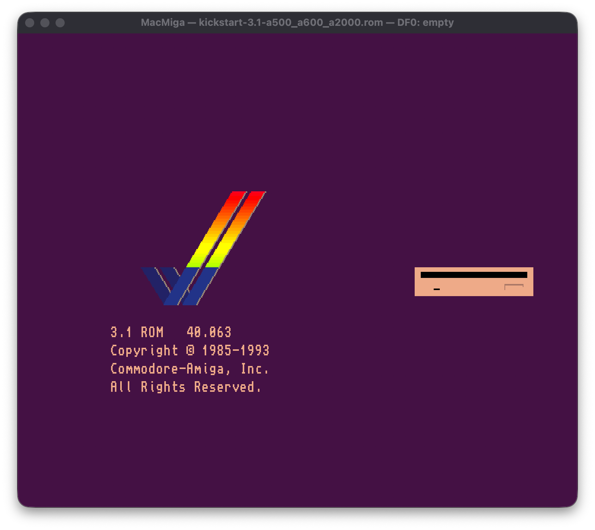
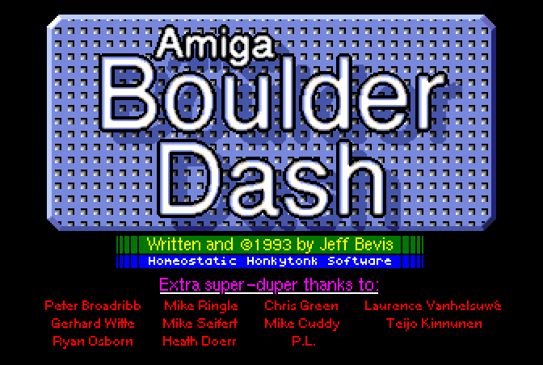
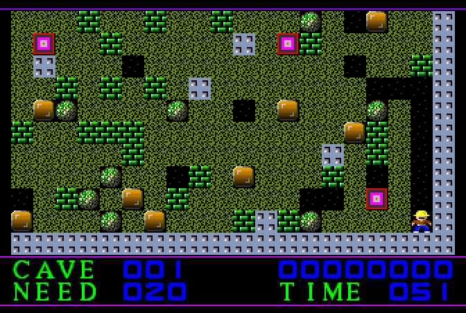

# MacMiga

A Commodore Amiga 500 emulator for macOS, written in Swift. MacMiga is open
source under the [MIT License](LICENSE) and a work in progress.

**[Website](https://macmiga.xcf.ai) · [Download 0.0.2](https://github.com/AgentiLoop/MacMiga/releases/tag/v0.0.2) · [Sister project: C64 / C128](https://c64.xcf.ai)**

The 0.0.2 download is a Universal app for Apple silicon and Intel Macs running
macOS 13 or newer, signed with Developer ID, notarized by Apple, and stapled.
Unzip it, move MacMiga.app to Applications, then supply your own Kickstart ROM
and disk images. No ROMs, operating systems, or games are included.
From 0.0.2 on the app checks for new releases and installs them itself
(MacMiga ▸ Check for Updates…). Compatibility is still evolving.

<table>
  <tr>
    <td width="50%"></td>
    <td width="50%"></td>
  </tr>
  <tr>
    <td align="center">The MacMiga window, Kickstart 3.1 waiting for a disk</td>
    <td align="center">Kickstart 1.3 waiting for a disk</td>
  </tr>
  <tr>
    <td width="50%"></td>
    <td width="50%"></td>
  </tr>
  <tr>
    <td align="center">Kickstart 3.1 booted from a hard disk image</td>
    <td align="center">AROS, started from its boot floppy</td>
  </tr>
  <tr>
    <td width="50%"></td>
    <td width="50%"></td>
  </tr>
  <tr>
    <td align="center">Amiga Boulder Dash (1993, PD), NTSC, title screen</td>
    <td align="center">Amiga Boulder Dash, NTSC, cave 1</td>
  </tr>
</table>

The first picture is a capture of the app's window. The others are frames
written by the emulator itself (`KickstartProbe --frames`, see "Local Kickstart
startup probe", or the same core driven by a small test program for the Boulder
Dash pictures, which are cropped as Crop Borders shows them), with each line
doubled as the app's window shows them.

## Status

**Current milestone: booting from ADF floppy images.** Both local Kickstart
ROMs draw their insert-disk screens and boot a bootblock from an ADF disk image,
which then reads further sectors through trackdisk.device. Paula audio is
emulated and played through the Mac's default output. The `MacMiga` app shows
the emulated display in a window and forwards the Mac keyboard and mouse. Booting real AmigaOS
Workbench disks has not been tested.

**Desktop (AROS):** AROS, the free AmigaOS-compatible system, boots from its
floppy under Kickstart 3.1 and, with the contents of its Live CD on a hard disk
image, comes up with its desktop (Wanderer): volume icons, a pointer that
follows the mouse, windows that open on a double-click and pull-down menus.
With AROS's own two ROM files in place of Kickstart the same desktop comes up,
so no Commodore ROM or disk is needed. See "AROS".

**Hard disk:** a hard disk image (`.hdf`) can be attached: either a hardfile
(one AmigaDOS partition, mounted as `DH0`) or a partitioned image with a Rigid
Disk Block, whose partitions are all mounted under their own names. A file
system stored in the partition table, such as PFS3, is loaded for its
partitions. Kickstart 3.1 and 1.3 both boot from it and run its
`S/Startup-Sequence`; see "Expansion boards and hard disk" below. A hardfile
can be made from a Mac folder or an LHA archive (see "Making a hard disk"); a
game made that way from an LHA archive started from the hard disk under
Kickstart 3.1. WHDLoad 20.1 runs from such a disk with Kickstart 3.1 and fast
RAM; one install (Pac-Man) has been tried. See "WHDLoad".

## Requirements

- macOS 13 or newer.
- A Swift 6 toolchain: Xcode 16 or newer, or a toolchain from swift.org. The
  last build was made with Swift 6.4.2 on macOS 27.2 (Apple silicon).
- A Kickstart ROM image, which is not included: a raw, unencrypted file of
  256 KiB or 512 KiB. Kickstart 1.3 and Kickstart 3.1 (A500/A600/A2000) are the
  two that have been run.

## Build from source

```sh
git clone https://github.com/AgentiLoop/MacMiga.git
cd MacMiga
swift build -c release
```

The package needs nothing from outside this repository (the 68000 core is the
local package `Packages/M68K`). The build puts three programs in
`.build/release`: `MacMiga`, the app, and the command-line tools `MakeHardfile`
(see "Making a hard disk") and `KickstartProbe` (see "Local Kickstart startup
probe").

`Bundle/make-app.sh` builds a Universal (Apple silicon + Intel) app at
`.build/MacMiga.app`, with the icon drawn by `Bundle/MakeIcon.swift` and the
`Info.plist` from `Bundle/`. It uses a Developer ID Application identity when
available, otherwise ad-hoc signing for local builds.

`Bundle/make-app.sh --release` requires Developer ID signing, enables the
hardened runtime, submits the archive to Apple, staples and validates the ticket,
and checks Gatekeeper before creating `.build/MacMiga-0.0.2-universal.zip`
and `.build/SHA256SUMS.txt`. The default notary keychain profile is
`App Store Connect Profile`; override it with `NOTARY_PROFILE`, or choose a
signing identity with `SIGN_ID`.

Sister project: [C64 / C128 for macOS](https://c64.xcf.ai), with
[source on GitHub](https://github.com/AgentiLoop/c64).

## Run the app

```sh
swift run -c release MacMiga path/to/kickstart.rom [extended.rom] [disk.adf] [disk.hdf]
```

A second ROM file, given right after the first, is an extended ROM for
`$E00000` (AROS's ROM comes as two files; a Kickstart needs none). Machine ▸
Open Extended ROM ($E00000)… adds one to the running machine and restarts it;
opening a Kickstart ROM removes it again. Both are remembered for the next
launch.

The examples in this README keep the ROMs in a folder named `Kickstart ROMs`
inside the repository. Git ignores ROM, ADF and HDF files, so they stay out of
commits.

A `.hdf` argument, or Machine ▸ Attach Hard Disk (DH0)… (⌘D), attaches a
hardfile and restarts the machine; Detach Hard Disk removes it. Blocks the
Amiga writes are saved back into the file about once a second and on quit (a
file that is not writable is attached write-protected). Machine ▸ New Hard Disk
from Folder or LHA… asks for a folder or archive and for where to save the new
`.hdf`, builds it and attaches it. Machine ▸ Fast RAM
adds a Zorro II memory board of 1, 2, 4 or 8 MB (None by default, remembered,
restarts the machine). On the command line `-FastRAM 4` sets the size for
that run; `-FastRAM YES` means 8, as it did when the setting was a switch.
Machine ▸ 1 MB Chip RAM (ECS Agnus) doubles chip RAM and swaps the Agnus (same
rules; see "Chip RAM and the ECS Agnus"). Machine ▸ Warp Speed (⌘T) runs the
emulation as fast as the Mac allows instead of at 50 frames a second, without
sound, which shortens long loading times; the window title shows "warp". It is
off at every launch unless the app is started with `-Warp YES`. Machine ▸
Instant Load (Skip Disk Wait) (⌘L, on by default and remembered) runs at warp
speed only while the floppy is busy: while its motor is on and the drive has
stepped, spun up or transferred data within the last emulated second. Sound is
skipped during those stretches, as with Warp Speed.

Machine ▸ Video Standard picks PAL (50 Hz), NTSC (60 Hz) or Auto (the default).
NTSC is an NTSC Amiga: 262-line frames, 60 a second, the NTSC Agnus ID in VPOSR
and the NTSC audio clock. Games made in the US (such as Amiga Boulder Dash) run at
their intended pace this way and move evenly on a 60 Hz display.

Auto works like the C64 emulator's: the machine starts as PAL and watches what the
running program does with the lines only a PAL frame has (262–311). A Copper list
waiting for one of them, or a display window reaching into them, is PAL evidence;
two such frames switch an NTSC machine back to PAL. Three seconds of pictures
without any switch a PAL machine to NTSC (six seconds after a return to PAL, then
twelve, so a program that only now and then uses them settles on PAL). The switch
happens between frames, without a restart. On the test disks Amiga Boulder Dash
switches to NTSC when its first cave starts; 8 of 12 PAL games stay PAL; Lotus,
Nicky Boom, Supercars II and Zeron never use a PAL-only line and switch to NTSC,
where they run about 20% fast, as they did on American Amigas.

Choosing PAL or NTSC with a disk in fixes that disk to it (remembered by file name;
inserting the disk later restarts the machine in that standard), and choosing Auto
forgets it. Disks whose file name carries a `(NTSC)` or `(PAL)` tag, as in TOSEC
sets, are fixed to that standard. The window title shows "PAL" or "NTSC" for the
standard the machine is in.

View ▸ Crop Borders (⌘B) fits the window to the area the game shows bitplanes in,
top, bottom, left and right, with a little border, once that area has stayed the
same for half a second. View ▸ Sync to Display (on by default) runs one Amiga
frame per display refresh (one per two at 100 Hz and up): smooth on a 60 Hz
display, though a PAL game then runs 20% fast (its sound is sped up to match).
With it off, frames run at the machine's own rate, and View ▸ Frame Blending
mixes the two latest frames on each refresh so a 50 Hz game moves evenly on a
60 Hz display, at the cost of slight ghosting.

MacMiga ▸ Check for Updates… looks for a newer release on GitHub (the app also
looks shortly after launch and every six hours), and installs it after checking
that it is signed with the same Developer ID ([AutoUpdateKit](https://github.com/AgentiLoop/AutoUpdateKit)).

With no arguments it reuses the last ROM, or `Kickstart ROMs/kickstart-1.3.rom`
in the current folder, or asks for one. The Machine menu opens a Kickstart ROM
(⌘K), inserts (⌘O) or ejects (⌘E) a DF0 ADF or DMS image, and resets (⌘R). Files can also be
dropped on the window: a `.rom` or `.bin` is opened as the Kickstart (and
remembered, as from the menu), an `.adf` or `.dms` goes into DF0 and an `.hdf` is attached
as DH0. The window shows
the full 736×312 frame doubled vertically, emulating frames on the main thread
as the display refreshes (Metal, drawn on vsync). Keys map by US-layout position to Amiga raw codes
(Command → Amiga keys, Option → Alt, Page Up/Help → Help); Command-key shortcuts
go to the menu instead, so the Amiga keys only work as plain modifiers. A click
in the window captures the Mac pointer for the Amiga mouse, and pressing ⌘
gives it back. The joystick in port 2 is on the numeric keypad (8/2/4/6 steer,
7/9/1/3 are the diagonals, 0, 5 and Enter fire) and right Option also fires;
Machine ▸ Arrow Keys Control Joystick (Port 2) (⌘J) puts it on the arrow keys,
and a game controller steers it too. Audio plays through AVAudioEngine at the output
device's sample rate with at most ~100 ms queued; silence is inserted when the
emulator falls behind. Verified on November 25, 2026 by launching it
with Kickstart 3.1 and screen-capturing the window, which showed the
insert-disk screen; keyboard and mouse input in the app were not tested by hand.

## Test

```sh
swift test
swift test --package-path Packages/M68K
```

`swift test` runs the tests of the Amiga machine and the second command those
of the CPU package; add `-c release` to either for a release build (see
"Tests"). The library product is `MacMigaCore`. The 68000 core is a separate package,
`Packages/M68K`, with no Amiga code in it (see "CPU package"). Tests use generated byte arrays rather
than proprietary firmware. No Kickstart ROMs or disk images are included.
Supply your own authorized, raw, unencrypted ROM when integrating the core.

## Implemented subset

`Sources/MacMigaCore/AmigaMemory.swift` provides:

- 512 KiB zero-initialized chip RAM at `$000000`–`$07FFFF`, repeated through
  `$1FFFFF` (the chip-RAM space Gary routes to Agnus). `chipRAMSize:` can make
  it 1 MiB or 2 MiB instead; see "Chip RAM and the ECS Agnus".
- 512 KiB slow RAM at `$C00000`–`$C7FFFF` by default (A500 + A501 trapdoor
  expansion; `slowRAMSize: 0` gives a stock 512 KiB machine). The rest of
  `$C00000`–`$D7FFFF` mirrors the custom chip registers, which Kickstart detects
  by writing INTENA through it.
- The Zorro II autoconfig window at `$E80000`. With no expansion boards (the
  default) it is empty: reads return 0 and writes are ignored. Optional boards
  are described under "Expansion boards and hard disk".
- A 512 KiB ROM window at `$F80000`–`$FFFFFF`, accepting 256 KiB images
  mirrored within that window or a full 512 KiB image.
- A power-on ROM overlay over the first 512 KiB only, controlled by CIA-A PA0 (OVL,
  pulled up while PA0 is an input). Writes to ROM-selected addresses are ignored.
- Both CIAs (`CIA8520.swift`) decoded across `$A00000`–`$BFFFFF`: CIA-A on odd
  bytes when A12 is low, CIA-B on even bytes when A13 is low, register from
  A8–A11. Ports with data direction, timers A/B (latch, one-shot/continuous,
  force load, high-byte start in one-shot, B counting A underflows), 24-bit TOD
  with alarm and read latch, SDR storage, and ICR mask/clear-on-read. Timers and
  TOD are driven by `AmigaMachine` (see below).
  An unselected CIA byte lane reads `$FF` (real hardware: open bus).
- OCS custom chip registers (`CustomChips.swift`) at `$DFF000`–`$DFFFFF`,
  mirrored every `$200`: set/clear DMACON, INTENA, INTREQ and ADKCON with their
  read-back registers, Paula interrupt-level priority, a PAL (or NTSC) beam counter for
  VPOSR/VHPOSR that raises VERTB each frame, and storage of all other writes.
  Word accesses are not split; a byte write appears on both bus halves. No DMA,
  video, audio, Blitter or Copper behaviour yet. Write-only registers read 0 (real hardware: bus noise),
  except DENISEID (`$07C`), which reads `$FFFF`: the OCS Denise has no ID
  register, and a low byte of 0 made Kickstart 3.1 detect an ECS Denise.
- Serial port: nothing is connected. SERDATR reads `$3800` (transmitter empty,
  receive line idle); a write to SERDAT is "sent" at once, raises the TBE
  interrupt request, and is kept in `custom.serialOutput` (the most recent
  64 KiB) for the host to read. Nothing is ever received; SERPER is ignored.
- `$D80000`–`$DFEFFF` (RTC, A600 Gayle/IDE on other models) is empty on a stock
  A500 here: reads return 0 and writes are ignored.
- `$E00000`–`$E7FFFF` is empty on an A500. `extendedROM:` fits a 512 KiB
  read-only ROM there, the place where a 1 MiB ROM keeps its second half
  (CDTV, CD32, and replacement systems such as AROS).
- The `$F00000`–`$F7FFFF` diagnostic-cartridge slot is empty: reads return 0
  (never the `$1111` signature) and writes are ignored. Real hardware returns
  open-bus data there.
- Big-endian byte, word, and longword access with 24-bit address masking.
- Rejection of odd-address word/longword access when the bus is used directly
  (the CPU never passes one on; it takes its address-error exception instead).
  Longwords can be word-aligned.
- `resetDevices()` is the reset line: the CIAs (which brings the ROM overlay
  back), the custom chips, the floppy drive's latches and the expansion boards
  return to their power-on state, and RAM keeps its contents. The CPU's RESET
  instruction calls it. `reset()` does the same and returns the vectors at
  addresses 0 and 4.

ROM validation checks size only, not contents, checksum, or compatibility.
Unimplemented addresses throw explicit errors rather than returning fake
peripheral data. This is a deliberately bounded CPU-side memory subset, not a
complete Gary/Agnus decoder: Zorro expansion memory, open-bus
behavior, DMA arbitration, and cycle timing remain unimplemented. Multiword
writes happen in order and are not rolled back if a subsequent access fails.

## CPU package

The 68000 core is its own Swift package in `Packages/M68K` (library `M68K`),
which the MacMiga package uses as a local dependency. It contains no Amiga
code, so other 68000 machines can be built on it; Mac Classic and NeXT
emulators are planned (NeXT needs a 68030/68040 with MMU and FPU, which this
core does not have).

- `M68KBus` is the protocol a machine implements for its memory map: big-endian
  `readByte/Word/Long(at:)` and `writeByte/Word/Long(_:at:)`, all throwing,
  and `resetDevices()`, which the RESET instruction calls (it does nothing
  unless the machine implements it). `AmigaMemory` conforms to it.
- `MC68000` is a value type holding only CPU state. `reset(memory:)` loads SSP
  and PC from addresses 0 and 4, `step(memory:)` executes one instruction and
  `interrupt(level:memory:)` presents an autovectored interrupt; each takes the
  bus as `inout`. The machine resets its own devices and decides when to
  interrupt.
- `step` returns the CPU clocks the instruction took (see "Instruction
  timing"), and 0 while the CPU is stopped. An accepted interrupt takes
  `MC68000.interruptClocks`, 44. The machine advances its own hardware by
  those amounts.
- After RESET the CPU executes the opcode it had already fetched, as a 68000's
  prefetch does, even if the reset changed what is at that address. Software
  that restarts a machine from RAM depends on this (`RESET` followed by a
  one-word `JMP (An)`, while the reset puts the boot ROM over the code).
- The CPU checks word and long accesses for odd addresses itself, so a bus
  needs no alignment rule. An error thrown by the bus stops `step` with the
  CPU's registers unchanged.
- The members are `@inlinable`, so a release build of the client compiles the
  CPU specialized for its bus type. Measured on November 25, 2026 with the
  probe (60,000,000 instructions, Kickstart 1.3 booting a game disk): 7.0 s of
  CPU time, against 6.9 s before the split when CPU and bus were one module.
  The saved frames and the written hard disk image were identical before and
  after.

`MacMigaCore` re-exports the two public types as `MC68000` and `CPUError`.

### Single-step tests

The package has a second program, `M68KSingleStep`, which runs the core against
the two sets of the SingleStepTests project. A test is one instruction with the
registers and memory before and after, and the number of clocks it takes.

| Set | Files | Tests | Made with |
| --- | --- | --- | --- |
| `github.com/SingleStepTests/680x0`, folder `68000/v1` | 124 `.json.gz` (about 190 MB) | 1,000,060 | a reference emulator |
| `github.com/SingleStepTests/m68000`, folder `v1` | 127 `.json.bin` (about 130 MB) | 317,500 | "the microcoded core in MAME", in its README's words |

Neither is in this repository, and neither was measured on a 68000.

```sh
swift run -c release --package-path Packages/M68K M68KSingleStep 68000/v1
swift run -c release --package-path Packages/M68K M68KSingleStep m68000/v1
swift run -c release --package-path Packages/M68K M68KSingleStep --show 5 68000/v1/ASR.b.json.gz
```

A test passes when all registers, SR, PC and every listed byte of memory match
and nothing else was written. The bus cycles and the prefetch queue are not
compared; the core models neither. The clocks are compared and counted apart;
they do not make a test fail. `--show N` lists the first N failures of each
file, `--address-errors` lists those among the address-error tests, `--clocks`
lists the tests whose time differs, and `--only TEXT` runs the tests whose name
contains TEXT. The second set records as PC the address of the next prefetch;
the program subtracts 4 to get the address of the next instruction.

Result on November 25, 2026:

| | 680x0 set | m68000 set |
| --- | --- | --- |
| Tests without an address error | 821,973 | 261,894 |
| of those, passing | 813,220 | 260,338 |
| of those, failing | 8,753 | 1,556 |
| of those, with a different time | 2,601 | 0 |
| Tests with an address error | 178,087 | 55,606 |
| of those, matching exactly | 54,524 | 24,061 |
| of those, matching except inside the exception frame | 63,120 | 16,251 |
| of those, differing elsewhere too | 60,443 | 15,294 |

The two sets disagree with each other, so no core can pass both. Where they
disagree MacMiga follows Motorola's manuals, and where the manuals call a
result undefined or give no figure, the m68000 set, because its generator
works at the level of the 68000's microcode.

The 8,753 failures against the 680x0 set:

- 3,736 are ASR by a register count larger than the operand's width, on a
  negative operand. That set expects C and X clear; MacMiga sets them, because
  every bit shifted out is a copy of the sign bit (Programmer's Reference
  Manual, ASR: "The carry bit receives the last bit shifted out of the
  operand"). The m68000 set expects the same as MacMiga.
- 4,693 are DIVU and DIVS with an overflow. N and Z are documented as
  undefined; that set leaves them as they were, the m68000 set has N set and Z
  clear, and so does MacMiga.
- 321 are CHK without a trap and with N set beforehand. N is documented as
  undefined; that set leaves it, the m68000 set clears it, and so does MacMiga.
- 2 are ASL.B tests whose expected result changes all 32 bits of the register,
  which a byte shift cannot do.
- 1 is that set's only division by zero, a DIVU. Its expected stacked PC is the
  instruction's own address; MacMiga stacks the next instruction's, as it does
  for CHK, where the set agrees. The m68000 set has no division by zero.

The 2,601 different times against the 680x0 set: 731 are ADDQ.L and SUBQ.L to
an address register (6 clocks there; 8 in the User's Manual's table 8-5, the
m68000 set and MacMiga), 1,265 are DIVS whose overflow shows only after the
division (16 or 18 there, plus the operand), and 605 are CHK traps (40 there,
38 in the m68000 set, when the register is negative and bound − register
overflows 16 bits).

The 1,556 failures against the m68000 set:

- 1,230 are STOP in supervisor mode and differ only in PC: the set's value is
  4 lower than its convention gives for every other instruction, which I take
  to mean that a stopped 68000 has not fetched ahead. MacMiga's PC is the
  address after STOP's two words.
- 326 are LINK A7. That set pushes A7 as it was before the instruction;
  MacMiga and the 680x0 set push A7 − 4, the value after the decrement, which
  is the order the Programmer's Reference Manual gives ("SP – 4 → SP; An →
  (SP)"). Not resolved.

The address-error tests that differ outside the frame do so in what the faulting
instruction had already changed, for example An after `-(An)` and SR. Inside
the frame, in the seven files of the 680x0 set I looked at, the difference is
the stacked PC. The time of an address error is a flat 50 clocks in MacMiga; in
the m68000 set's TST.W, CLR.L, ADD.L and MOVEM.W files it is 58 to 72, longer by
the time the instruction had already run, so most of those times differ
(133,714 and 48,739 tests). The address-error handling was not changed in this
round.

Running the sets found these faults, now fixed and covered by unit tests:

- ABCD could stop the emulator with a Swift arithmetic trap for some operands
  that are not valid BCD (the ABCD file ended with signal 5 before the fix),
  and SBCD and NBCD gave different results from the sets for such operands
  (7,052 tests).
- CHK took its exception with An as it was before `(An)+` or `-(An)`.
- A division by zero left N, Z, V and C as they were in the stacked SR; they are
  now clear, as the 680x0 set's one such test expects. It also keeps An as `(An)+` or
  `-(An)` left it, which is by analogy with CHK: neither set has a test of that.
- A jump to an odd address took its address error one step late, and JSR had
  pushed the return address by then.
- The address-error frame held only 24 bits of the access address and none of
  the opcode bits in its first word.
- A division that overflowed left N and Z as they were.

### Instruction timing

`step` returns the time of each instruction in CPU clocks. The figures are
those of tables 8-1 to 8-14 of the MC68000 User's Manual: 4 clocks for each bus
cycle of an operand or extension word, and the instruction's own time on top.
In four places both test sets have a different figure from the printed table,
and MacMiga uses theirs:

| Instruction | Table | Both sets and MacMiga |
| --- | --- | --- |
| ADDQ.W to an address register | 4 | 8 |
| ANDI.L to a data register | 14 | 16 |
| TAS on memory | 14 + operand | 10 + operand |
| BTST with an immediate operand | 8 | 10 |

Where the time depends on the data it is computed from the data:

- shifts and rotates take 2 clocks per bit;
- BCHG, BSET and BCLR on a data register take 2 clocks less for a bit below 16;
- MULU takes 38 clocks and 2 for each 1 in the source, MULS 38 and 2 for each
  change between neighbouring bits of the source with a 0 appended below it;
- DIVU takes 10 clocks on overflow and 76 to 136 otherwise, DIVS 16 or 18 on an
  overflow seen at once and 120 to 156 otherwise (the table gives only the
  maxima, 140 and 158). The rule is Jorge Cwik's description of the 68000's
  division as I remember it, not taken from a source in front of me; it gives
  the m68000 set's time in all 3,064 of its DIVU and DIVS tests without an
  address error;
- MOVEM takes 4 clocks per word moved;
- a trap takes 34 clocks, a division by zero 38 and CHK 38 or 40 plus the
  operand, an interrupt 44 and an address error 50.

All 261,894 tests of the m68000 set without an address error have the time
MacMiga returns, and 819,372 of the 821,973 of the 680x0 set (the other 2,601
are listed above). What is not modelled: where inside an instruction each bus
cycle falls, the time of an address error beyond the flat 50 clocks, and wait
states, which belong to the machine.

The package carries its own tests, 89 of them, and they use no Amiga code. The
instruction-level tests were moved here from the MacMiga test target. Their
checks are unchanged except in two places: the error for an address with
nothing behind it is now the test bus's own, and the reset test puts its
vectors in RAM instead of reading them through the Amiga's ROM overlay (the
MacMiga target has a test for that). They run on `TestBus`, a memory map
made for them: 2 MiB of RAM at `$000000`, 256 KiB of read-only ROM at
`$FC0000`, and a hole in between where every access throws. Nine more tests
run on a 64 KiB RAM bus (reset, a program with a loop and a subroutine, STOP
ended by an interrupt, the address-error frame, illegal and TRAP vectors, the
RESET instruction: the device reset, the kept prefetch, privilege, and an
interrupt discarding the prefetch, and trace: after an ordinary instruction,
not after the one that sets T or an illegal instruction, after TRAP, and
ending STOP). Seven tests check the time of about 125
instructions.
What the MacMiga target still tests of the CPU is its use in the machine:
interrupts, STOP, and power-on and reset through the ROM overlay.

## CPU subset

`Packages/M68K/Sources/M68K/MC68000.swift` implements D0–D7, A0–A7, banked
user/supervisor stack pointers, status bits, and external reset-vector loading.
The supported instructions are MOVE.B/W/L, MOVEA.W/L, LEA, PEA, JMP, JSR,
MOVEQ, ADD/ADDA/ADDQ/ADDI/ADDX, SUB/SUBA/SUBQ/SUBI/SUBX, CMP/CMPA/CMPI/CMPM,
NEG/NEGX/CLR/NOT/TST/TAS, AND/OR/EOR and their immediate forms (including to
CCR/SR), BTST/BCHG/BCLR/BSET, ASL/ASR/LSL/LSR/ROL/ROR/ROXL/ROXR (register and
memory), MULU/MULS/DIVU/DIVS, SWAP, EXT, EXG, MOVEM, MOVE to/from SR and CCR,
MOVE USP, LINK/UNLK, Scc, DBcc, Bcc/BRA/BSR, RTS, RTR, RTE, TRAP, TRAPV, RESET
(resets the devices on the bus), STOP, NOP, ABCD/SBCD/NBCD (for operands that are not valid BCD, and for the
undocumented N and V, the results are those of the single-step test set; see
"Single-step tests"), CHK.W (trap 6 if the register is negative or above the
bound; N set for a negative register and clear otherwise, Z/V/C cleared) and
MOVEP.W/.L. This completes the 68000 instruction set;
unassigned encodings and invalid addressing modes take the illegal-instruction
exception (vector 4, stacked PC = the opcode's address), as on hardware. Setting
`cpu.stopsOnIllegalInstruction = true` makes `step` throw
`CPUError.unsupportedInstruction` instead, which the decoder tests use.
MOVE supports register direct,
indirect, postincrement, predecrement, displacement, brief indexed, absolute,
PC-relative source, and immediate source addressing. LEA, JMP, and JSR accept
only control addressing modes and preserve condition codes. ADD and SUB set
X, N, Z, V, and C; address-register destinations (ADDA/SUBA and ADDQ/SUBQ to
An) use all 32 bits and leave flags unchanged. ADDX/SUBX/NEGX only clear Z.
Compares set N, Z, V, and C and leave X unchanged; CMPA compares all 32 bits
with a sign-extended word source. DBcc decrements only
the low word of Dn and leaves flags unchanged.
DIVU/DIVS overflow leaves the register unchanged, sets V and N and clears C and
Z (N and Z are documented as undefined; these are the m68000 test set's
values). A division by zero stacks SR with N, Z, V and
C clear. CHK and the divisions take their exception after `(An)+` or `-(An)`
has changed An.
Branches support byte and word displacements. Unsupported opcodes throw an
opcode/address diagnostic.

Exceptions: TRAP #n, TRAPV, privilege violation, divide by zero, ILLEGAL, line A,
line F, and MOVEC (68010+, executed by Kickstart to detect the CPU) are processed
the 68000 way: SR and the return PC are pushed on the supervisor stack and the
CPU jumps through the vector table.

Autovectored interrupts (`interrupt(level:memory:)`) are accepted at level 7 or
above the SR mask: SR and PC are stacked, the mask is raised and STOP ends.
Level 7 is treated as level-sensitive (real hardware: edge-triggered).

Each instruction is executed in one step and its time is returned (see
"Instruction timing"); the bus cycles inside it are not placed in time. The
prefetch is absent. Trace: an instruction that starts with SR's T bit set is
followed by the trace exception (vector 9, 34 clocks, the next instruction's
address stacked); it also follows TRAP, TRAPV, CHK and a division by zero, and
ends STOP, but not an illegal instruction, line A/F, a privilege violation or an
address error. `cpu.stopsBeforeTrace = true` leaves it out, as the single-step
test sets record their results. A word or long access to an odd address takes the address-error
exception: vector 3 with the 14-byte group 0 frame (access type and function
code, with the opcode's upper 11 bits above them; all 32 bits of the access
address; opcode; SR; PC). A jump, branch or return to an odd address takes it
in the same step, as the 68000 fetches from the target before the instruction
ends; JSR pushes no return address in that case. The stacked PC is the branch's
address + 2 for Bcc, BRA and BSR, the odd address for other fetch faults,
otherwise the instruction address + 2 (hardware
stacks 2–10 bytes past it). Both were needed by a cracked ADF of Super Cars
(1990), which still runs Rob Northen's Copylock code: it decrypts itself one
instruction at a time from the trace handler, then branches to an odd address
on purpose and adds up its own code as far as the stacked PC to find where to
go on. Without trace Kickstart 1.3 showed "Guru Meditation #00000003.00C05128";
on November 25, 2026 the probe ran it past the Copylock code into the game's own
code in chip RAM, with its display on. A fault while
writing that frame stops emulation instead of halting the CPU. Setting
`cpu.stopsOnAddressError = true` throws `CPUError.addressError` instead, as
the fault-preservation tests do. Unmapped addresses still stop
emulation with `MemoryBusError.unmappedAddress` (the A500 has no bus-error
source, so real reads there return bus noise).

## Machine loop

`Sources/MacMigaCore/AmigaMachine.swift` wires CPU and bus as a PAL A500 (or,
with `ntsc: true`, an NTSC one: 262-line frames and VPOSR's NTSC bit; lines stay
227 colour clocks, where real NTSC chips alternate 227 and 228). Before
each instruction Paula's interrupt level is presented to the CPU. Each instruction
takes the CPU clocks the 68000 core returns for it (see "Instruction timing"),
an accepted interrupt 44 more, and an idle step while stopped 4. The chipset
is advanced once per instruction, not per bus cycle, and takes no bus time
from the CPU: the blitter and the copying of disk DMA finish at once (DSKBLK
follows later, see "Video, Copper and Blitter") and bitplane DMA slows
nothing down. Until November 25, 2026 every instruction was counted as 10
clocks. In three probe runs of 60,000,000 instructions the average is now 11.1
(Kickstart 1.3 loading and running a game), 12.9 and 13.3 clocks (Kickstart 1.3
and 3.1 at their insert-disk screens), so the same program takes more frames
than before. That time advances the beam (1 colour clock = 2 CPU clocks;
VERTB each frame) and both CIA timers (1 E clock = 10 CPU clocks). CIA-A TOD
counts frames, CIA-B TOD counts lines. CIA-A /IRQ sets INTREQ PORTS (level 2),
CIA-B /IRQ sets INTREQ EXTER (level 6).

## Expansion boards and hard disk

`Expansion.swift` is the Zorro II AUTOCONFIG chain. Each unconfigured board in
turn answers at `$E80000` with its identification ROM in nibbles (inverted
except er_Type); writing its base address (`$4A`, then `$48`) maps it and lets
the next board answer, and `$4C` shuts it up. A reset unconfigures every board.
Two boards exist, both with manufacturer 2011 (the number reserved for boards
without a registered maker):

- Fast RAM (`fastRAMSize:`, a power of two from 64 KiB to 8 MiB, default none).
  Kickstart places it in `$200000`–`$9FFFFF` and adds it to the memory list.
- The hard-disk controller (`hardDisk:`), a 64 KiB board that is not a model of
  any real controller. Its boot ROM is generated for the assigned address
  (`$E90000` in practice) and holds a DiagArea with a Resident tag for
  `macmiga.device`. Kickstart copies the DiagArea and runs it: the device is
  created, and each partition of the disk is made a DOS device with MakeDosNode
  and queued with its boot priority (AddBootNode on Kickstart 2.0+, a BootNode
  on eb_MountList on 1.3; a hardfile is one partition, `DH0`, at priority 0),
  and the BootPoint starts dos.library. A bootable floppy in DF0 has the higher
  priority (5) and should still boot first; that was not tried.

The 68000 code in the boot ROM is about 180 instructions. The work is done by
the host through long-word registers on the board: `$8000` takes an
IORequest pointer and performs the command at once (CMD_READ, CMD_WRITE,
TD_FORMAT, TD_PROTSTATUS, TD_GETNUMTRACKS, TD_GETGEOMETRY; motor, seek, update,
clear and change-state commands succeed with nothing to do; TD_ADDCHANGEINT is
kept unanswered; anything else, including HD_SCSICMD and 64-bit commands,
returns IOERR_NOCMD), `$8004` fixes up the Resident tag in the DiagArea copy,
`$8008` fills in the device's library node, and `$8040` onwards load the file
systems of a partition table (see "File systems in the partition table"). The
controller only touches memory, never CPU registers.

`HardDisk` holds the image in one of two forms. A hardfile is one AmigaDOS
partition with no partition table, at
512-byte blocks, 1 surface, 32 blocks per track and 2 reserved blocks (the
layout UAE uses for hardfiles); blocks past the last whole cylinder are unused.
The DosType comes from the image's first four bytes (`DOS\0`…`DOS\7`), else
FFS. A partitioned image has a Rigid Disk Block (`RDSK`) in one of its first 16
blocks, as on a real drive; see "Partitioned images" below. An image whose
first block starts with `DOS` is always taken as a hardfile. Transfers
are instant. Only an OFS (`DOS\0`) hardfile was tried under Kickstart 1.3,
whose ROM has no Fast File System.

Measured with the probe on November 25, 2026, using 1 MiB hardfiles made by a
script (not committed) that hold only `S/Startup-Sequence` with two `Echo`
lines, the second redirected to `SYS:proof`:

| ROM | Hardfile | Result with `--limit 60000000` |
| --- | --- | --- |
| Kickstart 3.1 | FFS | boot shell shows the echoed line and a `1>` prompt; 9 blocks read, 6 written; the saved image has a new file `proof` with the echoed text and valid root and bitmap checksums |
| Kickstart 1.3 | OFS | CLI shows `Unknown command Echo` (1.3 has no built-in Echo) and a `1>` prompt; 7 blocks read |

With `--fast 8` both ROMs list a memory header at `$200000`–`$A00000` in
exec's memory list. In the app, the same FFS hardfile booted under Kickstart
3.1 and the file on disk received the same changed blocks. No Workbench
installation has been tried.

### Partitioned images

The Rigid Disk Block leads to a chain of partition blocks (`PART`). For each
one `HardDisk` takes the device name, the flags and the DosEnvec (geometry,
first and last cylinder, DosType, boot priority, up to 20 entries), and the
boot ROM mounts it under that name. All partitions are on unit 0 of
`macmiga.device`; the DosEnvec places each one on the disk. A partition
flagged "no automount" is left out. One not flagged "bootable" is mounted at
priority -128, which never boots. TD_GETGEOMETRY reports the cylinders, heads
and sectors from the Rigid Disk Block.

Rejected with an error: a table or partition block with a bad checksum or ID,
a chain that loops or leaves the image, a block size other than 512 bytes, a
partition that extends past the end of the image, and a table with nothing to
mount. Drive-init code (`rdb_DriveInit`, a program a real controller's ROM
may run to set up the physical drive) is deliberately not run: it talks to
drive hardware MacMiga does not have, and no image tried so far carries any.

Bad-block lists (`BADB` blocks, each with up to 61 pairs of a bad block and its
replacement) are honoured the way a controller's driver does it: a read or
write of a bad block goes to its replacement, and the bad block itself is never
touched. A damaged `BADB` block ends the list. Checked with the probe: in an
image from `MakeHardfile --rdb`, the boot partition's root block and the data
block of its startup-sequence were copied to spare blocks in the table's
cylinders, overwritten with `$DEAD`, and listed as bad; Kickstart 3.1 mounted
both volumes, ran the script and wrote its file to `DH1`, and the bad blocks
still held `$DEAD` afterwards.

Checked on November 25, 2026 with the probe. The images were made by a script
(not committed) that puts volumes from `MakeHardfile` behind a Rigid Disk Block
it writes itself. Images partitioned on an Amiga were tried afterwards (below).

| ROM | Image | Result |
| --- | --- | --- |
| Kickstart 3.1 | 2 heads × 16 sectors; `DH0` bootable, `DH1` not bootable, `DH2` no automount | booted from `DH0`; its script found a file on `DH1:` and wrote one there, and the changed blocks all lie inside `DH1`'s range. A script that named `DH2:` got AmigaDOS's "Please insert volume DH2" requester |
| Kickstart 3.1 | the same two volumes, `DH0` at priority 0 and `DH1` at priority 2 | booted from `DH1`, whose script found `DH0:S` |
| Kickstart 3.1 | 16 heads × 63 sectors, two partitions | booted from `DH0`, wrote and found a file on it, and found a file on `DH1:` |
| Kickstart 1.3 | 2 heads × 16 sectors, two OFS partitions, `DH1` not bootable | booted from `DH0` (the CLI named the command from `DH0`'s script as unknown, 1.3 having no built-in commands) |
| Kickstart 1.3 | the same, `DH1` at priority 3 | booted from `DH1` |
| Kickstart 3.1, 8 MiB fast RAM | HstWB Installer's image template `2gb_hdf_rdb_dh0-100mb-dos7_dh1-1.7gb-dos7` (partitioned with HDToolBox, 16 heads × 63 sectors, 1,900,000,000 bytes) | the table's FastFileSystem 45.16 was loaded for the two `DOS\7` partitions, which Kickstart's own FFS cannot read; both volumes, "Workbench" and "Work", were mounted and Kickstart booted from `DH0` to the shell prompt (the volumes are empty) |
| Kickstart 3.1, 8 MiB fast RAM | the template `4gb_hdf_rdb_dh0-100mb-pds3_dh1-3.4gb-pds3` (3,800,000,000 bytes) | pfs3aio 19.2 from the table handled both `PDS\3` partitions; both volumes mounted, the second ending 3.8 GB into the image |
| Kickstart 3.1, 8 MiB fast RAM | the template `8gb_hdf_rdb_dh0-100mb-pds3_dh1-6.9gb-pds3` (7,600,000,000 bytes) | both volumes mounted; the second ends 7.6 GB into the image, and before the device had the 64-bit commands (below) only the first was mounted |

Disks over 4 GiB: io_Offset has only 32 bits, so the device also carries out
the 64-bit commands file systems use for such disks, TD64 (`TD_READ64`,
`TD_WRITE64`, `TD_SEEK64`, `TD_FORMAT64`, commands 24–27) and NSD
(`NSCMD_TD_READ64` … `NSCMD_TD_FORMAT64`, `$C000`–`$C003`), with the offset's
upper half in io_Actual, and answers `NSCMD_DEVICEQUERY` (`$4000`) with a
trackdisk-like device type and the list of its commands. Hard disk images are
read from a mapped file, so a large one is held in memory once (the probe used
3.9 GB for the 7.6 GB image).

These images are not a whole number of blocks long (1,900,000,000 bytes is
3,710,937½ blocks), which `HardDisk` used to reject; the part block at the end
is now left out. The templates are at
`github.com/henrikstengaard/hstwb-installer/tree/master/images`; they are not
in this repository (their partition tables carry the file system programs).

The frames from hardfiles (a Kickstart 3.1 shell boot, WHDLoad with Pac-Man,
and the Kickstart 1.3 boot) are identical to those before this change. Whether
Kickstart 1.3 also mounts the partition it did not boot from was not checked.

### File systems in the partition table

A partition table can carry file systems: a header block (`FSHD`) with the
partition type (DosType) it serves, a version and the values for the DOS
device node, and the program itself in a chain of `LSEG` blocks. That is how a
drive brings along a file system Kickstart does not have in ROM, for example
PFS3 or SFS, or the Fast File System for Kickstart 1.3. MacMiga installs them
the way a real controller's ROM does:

- `HardDisk` reads the headers and their programs. The program is an AmigaDOS
  load file ("hunks"); `HunkFile` reads code, data and BSS hunks and 32-bit
  relocations in the long and the short form, and skips symbol, debug and name
  blocks. Overlays are not read.
- The boot ROM opens `FileSystem.resource`, or makes it if Kickstart has none.
  For each file system of the table it looks for an entry of the same DosType.
  Unless the resource has one in the same or a newer version, the ROM allocates
  memory (one block for all hunks), the host puts the relocated program there
  as a segment list, and the ROM adds a FileSysEntry to the resource.
- For each partition whose DosType has a file system in the table, the ROM
  takes the newest entry of that type from the resource and patches the
  partition's device node as the entry's patch flags say (usually the segment
  list and a global vector of -1). So if Kickstart's own file system of that
  type is as new as the table's, Kickstart's is used.
- Partitions of a type the table has no file system for are left to Kickstart,
  exactly as before.

A header block with a bad checksum or ID ends the list at that point; the
disk stays usable. A file system whose `LSEG` blocks are damaged, or whose
program is not a load file `HunkFile` reads, is listed but not installed, and
its partitions are left to Kickstart. At most 16 file systems are installed.

Checked on November 25, 2026 with PFS3 (pfs3aio 3.1 from Aminet, version 19.2
of the handler, one hunk of 58,240 bytes with 207 relocations). No Amiga-made
partition table was at hand: a script (not committed) wrote the table with the
handler in 121 `LSEG` blocks. The file system and the test files are not in
this repository.

| Step | Result |
| --- | --- |
| AROS (its own ROMs, the boot floppy, 8 MiB fast RAM), disk with an FFS partition and an empty partition `DH1` of type `PFS\3` | the handler from the table was running for `DH1`. AROS's `Format DRIVE DH1: NAME PTest QUICK` put up PFS3's own notice (it names "Professional File System 3 19.2" and the "All-In-One version") and finished; `Copy` and `Makedir` wrote files, `Dir` listed them, and `Info` showed `DH1: 3.6M … read/write PFS3 PTest`. 82 blocks written |
| Kickstart 3.1, a 5 MB disk with that PFS3 partition at boot priority 5 and an FFS partition at 0 | booted from the PFS3 partition: its `S/Startup-Sequence` printed its line, wrote a file with `Echo >SYS:written`, and `If EXISTS` found that file and one written under AROS. `FileSystem.resource` had `PFS\3` 19.2 ahead of Kickstart's own entries. The saved image differs from the original only in 10 blocks, all of the PFS3 partition, one of them a new block with the written text |
| Kickstart 1.3, the same disk | the boot ROM made `FileSystem.resource` (Kickstart 1.3 has none; its only entry was `PFS\3`); the handler was running, the volume `PTest` was mounted, and the CLI read the PFS3 partition's `S/Startup-Sequence`: it showed `Unknown command Echo`, 1.3 having no built-in commands. The FFS partition was not mounted as a volume, 1.3 having no Fast File System |
| The app with Kickstart 3.1 and the same disk, after 25 seconds at warp speed | the window showed the three lines of the PFS3 partition's script |

The screen texts were read from saved frames by OCR. Not tried: a table with
several file systems on a real Kickstart (the unit tests cover it), the Fast
File System from a Workbench disk under Kickstart 1.3, and Workbench itself on
such a disk.

SFS (Smart File System) cannot run on MacMiga, which emulates a 68000: every
m68k version needs a 68020. Tried with `MakeHardfile --rdb`, a `DH0` whose
startup-sequence runs `SFSformat`, and an empty `SFS\0` partition `DH1`, on
Kickstart 3.1 with 8 MiB fast RAM: the table's file system was installed and
its handler started, then failed with "Software Failure … Program failed" —
SFS 1.279 (Aminet `disk/misc/SFS.lha`) at a `BSR.L` (`$61FF`, an address error
on a 68000) and the original SFS 1.84 (amiga-stuff.com) at a `MULU.L`
(`$4C41`, an illegal instruction). A real 68000 Amiga fails the same way. SFS
waits for a 68020 CPU (see "Next milestones").

The probe now prints the file systems of the table, the entries of
`FileSystem.resource`, and DOS's devices (with the segment list and whether
the handler is running) and volumes.

## Chip RAM and the ECS Agnus

The stock machine has 512 KiB of chip RAM and the OCS Agnus (8371), which
cannot address more. `chipRAMSize:` (probe `--chip 1024` or `--chip 2048`, app
Machine ▸ 1 MB Chip RAM) fits 1 MiB or 2 MiB together with an ECS Agnus, as in
late A500s with the 8372A. Denise and Paula stay OCS. Slow RAM is a separate
setting and stays at 512 KiB unless changed (on a real A500 the 1 MiB of chip
RAM is usually made by remapping the trapdoor RAM).

What the ECS Agnus changes here: the ID in VPOSR bits 14–8 reads `$20` instead
of `$00`; every DMA pointer (Copper, bitplanes, sprites, Blitter, disk, audio)
reaches all of chip RAM; and three Blitter registers exist: BLTCON0L (`$05A`,
the minterm byte of BLTCON0), BLTSIZV (`$05C`) and BLTSIZH (`$05E`) for blits
up to 32,768 lines by 2,048 words, started by the BLTSIZH write. With the OCS
Agnus those three addresses do nothing. Not modelled: BEAMCON0 and the
programmable beam registers (stored without effect; the beam stays PAL or NTSC)
and DIWHIGH.

Measured with the probe on November 25, 2026 (60,000,000 instructions, no
disk), reading exec's memory list and graphics.library's chip revision byte
out of the running system:

| Chip RAM | Kickstart 3.1 | Kickstart 1.3 |
| --- | --- | --- |
| 512 KiB | chip memory `$000420`–`$080000`; ChipRevBits0 `$00` (no ECS chip) | chip memory `$000420`–`$080000` |
| 1 MiB | chip memory to `$100000`; ChipRevBits0 `$01` (ECS Agnus, OCS Denise) | chip memory to `$100000` |
| 2 MiB | chip memory to `$200000`; ChipRevBits0 `$01` | chip memory to `$200000` |

The saved insert-disk frames are identical for all three sizes with each ROM.
That needed BLTCON0L: Kickstart 3.1 draws its text through that register once
it has found an ECS Agnus, and without it the four lines of text on the
insert-disk screen were missing. Kickstart 3.1 used BLTCON0L, BLTSIZV and
BLTSIZH in these runs. Before the DENISEID change, ChipRevBits0 read `$12` on
the 512 KiB machine. For software that needs the extra chip memory, see
"WHDLoad".

## Making a hard disk

```sh
swift run -c release MakeHardfile [--name VOLUME] [--free MiB] [--startup "COMMAND"]... [--exclude PATH]... [--auto] [--ofs] [--intl] [--dircache] [--kickstart ROM]... [--skip-long-names] <folder | archive.lha>... <output.hdf>
swift run -c release MakeHardfile --rdb [--fs HEXTYPE:VERSION.REVISION:FILE]... <PARTITION>... <output.hdf>
swift run -c release MakeHardfile --list <folder | archive.lha>
swift run -c release MakeHardfile --extract <archive.lha> <new folder>
```

`--extract` only unpacks an LHA archive into a folder on the Mac, for instance
to get at an ADF inside it.

`MakeHardfile` writes a hardfile holding the contents of Mac folders and LHA
archives, ready to attach as DH0. Several sources are merged into one volume
(directories with the same name are combined; a file found in more than one
source is taken from the last). `--startup` puts the given text in
`S/Startup-Sequence` (replacing one from the sources), and each further
`--startup` adds a line, so
`--startup "pacman_HD/pacman"` makes a disk that starts that program when it
boots. Without a startup-sequence Kickstart 3.1 boots to a `1>` shell prompt.
The volume is named after the first folder or archive unless `--name` is given, and
has 2 MiB of free space, or a quarter of its contents if that is more, unless
`--free` is given. `--exclude PATH` leaves out a file or a directory with
everything in it (the path counts from the top of a source, in any case, and
the option can be repeated). `--skip-long-names` leaves out, and lists, the
files and directories whose names an Amiga volume cannot hold, instead of
stopping at the first one. `--auto` writes a startup-sequence that runs the
sources' only program when they have exactly one (WHDLoad `.slave` files are
not counted; with one slave and WHDLoad itself among the sources, it starts the
slave through WHDLoad, see "WHDLoad") and no startup-sequence of their own; `--ofs` writes the old file
system, for Kickstart 1.x; `--intl` the international mode (`DOS\3`, or
`DOS\2` with `--ofs`), in which names also match regardless of the case of
accented letters (Kickstart 2.04 and later). The `--startup` text is written in
ISO Latin-1, the character set AmigaDOS reads, with accents composed (macOS
may pass them decomposed on a command line). The app's Machine > New Hard Disk from Folder or LHA…
does both itself, choosing OFS when the loaded Kickstart is older than 2.0.

`--rdb` puts hardfiles behind a partition table instead (`RigidDiskBuilder`):
each `NAME=FILE.hdf` becomes a partition byte for byte, `NAME=<MiB>M,type=HEXTYPE`
an empty one to format on the Amiga, and `,pri=N`, `,noboot`, `,nomount` and
`,type=HEXTYPE` set its boot priority, flags and DosType (otherwise taken from
the volume's `DOS\n` signature). Each `--fs` stores a file system program in
the table. The geometry is 1 head × 32 sectors, the table takes the first two
cylinders (more if the file systems need it), and partitions follow in the
order given. For example
`MakeHardfile --rdb --fs 50465303:19.2:pfs3aio DH0=system.hdf DH1=work.hdf,noboot DH2=pfs.part,type=50465303,noboot disk.hdf`
made an image from which Kickstart 3.1 booted, writing files to the OFS
`DH1` and the PFS3 `DH2`, and Kickstart 1.3 booted (with an OFS `DH0`) and
mounted all three volumes.

`VolumeBuilder.swift` (`FastFileSystem.hardfile`) writes the volume: Fast File
System (`DOS\1`), 512-byte blocks, root block in the middle, hash-table
directories with chains in ascending block order, file headers with extension
blocks, and a bitmap with extension blocks for volumes over 52 MB. Limits:
names of at most 30 ISO Latin-1 characters without `/` or `:` (anything else
is an error, nothing is renamed or cut), volumes up to 2 GiB, no links. With
`fastFileSystem: false` it writes the old file system (`DOS\0`, data blocks of
488 bytes behind a header), which is what Kickstart 1.3's ROM reads, and with
`international: true` the international mode, whose hash and name comparison
also fold à–þ (except ÷) to upper case. Checked on Kickstart 3.1: on a volume
holding `Obst/äpfel`, `If EXISTS OBST/ÄPFEL` found the file on a `DOS\3`
volume and not on a `DOS\1` one, and `OBST/äpfel` was found on both.

`directoryCache: true` (MakeHardfile `--dircache`) writes the directory-cache
modes, `DOS\5` (FFS) or `DOS\4` (OFS with `--ofs`), which Kickstart 3.0 and
later read: on top of the international mode, every directory points (long 126
of its header, the root's too) to a chain of cache blocks (type 33) listing
each entry's header block, size, protection, date, type, name and comment, so
that a directory scan reads a few blocks instead of every header. Checked on
Kickstart 3.1 with a small program that lists a directory through `Examine`
and `ExNext` (assembled with vasm; not in the repository): it listed every
entry on `DOS\5` and `DOS\4` volumes, and listed a new file after the script
had written one, so FFS kept the cache up to date; with one name changed in
the cache block only, the listing showed the changed name, so the listing came
from the cache; and after the root's bitmap flag was cleared, the validator's
rebuilt bitmap matched the writer's except for the two blocks of the file the
script wrote. The long-name modes (`DOS\6`, `DOS\7`) are not written. From a
Mac folder only regular files and directories are taken; symbolic links,
`.DS_Store` and `._*` files are left out, and dates are modification dates in
local time.

`LHA.swift` (`LHA.unpack`) reads LHA archives with header levels 0, 1 and 2 and
the methods `-lh0-` and `-lz4-` (stored), `-lh1-` (LHarc 1.x and early Amiga
LhA: a 4 KiB window and an adaptive Huffman code), `-lh4-` to `-lh7-`, `-lzs-`
and `-lz5-` (LArc, LHarc's predecessor) and `-lhd-` (directories), checking
each file's CRC-16. The rarer `-lh2-`, `-lh3-` and PMarc's methods are reported
as unsupported. The older methods were checked against archives from Lhasa's
test suite (LhA 1.22 for Amiga, LHArc 1.13c and LArc 3.33, kept in
`Tests/MacMigaCoreTests/Fixtures/LHA` under Lhasa's ISC license): every member
passes its CRC, `-lh1-` and `-lz5-` unpack to the same text as the stored
archive's, a 1.2 MB `-lh1-` file exercises the adaptive code's rebuilds, and a
crafted `-lz5-` archive copies all of LArc's initial window. No `-lzs-` archive was at
hand; that decoder follows Lhasa's and is checked with a hand-made stream. For archives made on an Amiga the protection bits and
file comments are kept.

Checked on November 25, 2026 with Kickstart 3.1 and the probe:

| Hardfile | Result |
| --- | --- |
| from a game's LHA archive (4 files, one program of 236,416 bytes; every CRC-16 matched), with `--startup` naming the program | the program was loaded from DH0 (479 blocks read) and drew its maze screen, with the same display registers and palette as a floppy image of the game shows under Kickstart 1.3 |
| from a Mac folder: a 40 KB startup-sequence (80 blocks, so it needs an extension block), 200 files in one directory, nested and empty directories | the script ran to its last line; its `If EXISTS` tests found a file in the 200-file directory, a nested file and the empty directory, and a file it wrote was found again |
| the archive's volume, and a 60 MB one (31 bitmap blocks and a bitmap extension block), each with its bitmap marked invalid | AmigaDOS validated the volume and wrote a bitmap marking exactly the same blocks free as the writer had |
| the same 60 MB volume, unmodified | mounted with 37 blocks read (the 31 bitmap blocks among them) and none written |

The app's New Hard Disk menu item was built but its file panels were not
operated; it calls the same code as the tool (with one source).

## WHDLoad

WHDLoad runs installed games from a hard disk. It is not part of MacMiga: get
the WHDLoad package from whdload.de and the install for a game you own, and
put both on one hardfile. WHDLoad needs Kickstart 2.0 or newer and more memory
than the stock machine has, so use Kickstart 3.1 and turn on Machine ▸ Fast
RAM (`--fast` in the probe).

In the app, Machine ▸ New Hard Disk from Folder or LHA… recognises an install
(exactly one `*.slave` program and no WHDLoad): it offers to add WHDLoad's
archive or folder (remembered for next time), writes a startup-sequence that
changes to the install's directory and starts WHDLoad with the slave, and
turns on 8 MB of fast RAM if there was none. `MakeHardfile --auto` writes the
same startup-sequence when the sources include WHDLoad (a program `C/WHDLoad`
anywhere): `MakeHardfile --auto pacman_HD.lha WHDLoad_usr_small.lha whd.hdf`
gave `CD pacman_HD` and `SYS:WHDLoad/C/WHDLoad pacman.slave PRELOAD`, and the
probe (Kickstart 3.1, 8 MiB fast RAM) showed the game running from fast RAM
with the same display registers and palette as below. The app's dialogs were
not operated in this check.

Some installs run the game on WHDLoad's Kickstart emulation and need a
Kickstart image in `Devs:Kickstarts` under a fixed name (`kick34005.A500` for
1.3, `kick40063.A600` for the 3.1 ROM of the A500/A600/A2000, and so on),
beside its relocation file (`kick34005.A500.RTB` …, from Aminet's
`util/boot/skick346.lha`). `MakeHardfile --kickstart ROM` puts a ROM there
under that name when WHDLoad knows its CRC-32 (a 256 KiB image stored twice
in a 512 KiB file is taken once); the app does the same, when it adds WHDLoad,
with every known Kickstart in the folder of the loaded one. The `.RTB` files
must come with the sources, for example a folder holding
`Devs/Kickstarts/kick34005.A500.RTB`. Checked with WHDLoad's own Workbench 1.3
install (whdload.de `apps/Workbench13.lha`, whose slave boots Kickstart 1.3
under WHDLoad and takes its `data` directory as the boot volume), an empty
`data` apart from a one-line startup-sequence, and
`MakeHardfile --auto --kickstart kickstart-1.3.rom --kickstart kickstart-3.1-….rom`:
on Kickstart 3.1 with 1 MiB of chip and 8 MiB of fast RAM the screen showed
Kickstart 1.3's shell ("Copyright 1987 Commodore-Amiga, Inc.", "Release 1.3")
and its "Unknown command" for the script's line, 1.3 having no built-in
commands. With 512 KiB of chip RAM WHDLoad said the slave needs chip memory up
to `$FF000`; the slave asks for 1 MiB of base memory.

Saving: a program in that `data` directory (assembled with vasm, not in the
repository) opened `SYS:saved` and wrote 18 bytes while Kickstart 1.3 ran
under WHDLoad. Nothing reached the hard disk while the slave ran; after F10
(the quit key, sent by the probe) WHDLoad returned to Kickstart 3.1's shell
and wrote the file: the saved image holds `Workbench13/data/saved` (18 bytes,
the program's text) in 6 newly written blocks. WHDLoad keeps what a game saves
in memory until it quits, so quit with the game's quit key before closing
MacMiga, or the saves are lost.

```sh
swift run -c release MakeHardfile --name WHD \
    --startup "CD pacman_HD" --startup "SYS:WHDLoad/C/WHDLoad pacman.slave PRELOAD" \
    pacman_HD.lha WHDLoad_usr_small.lha whd.hdf
swift run -c release MacMiga "Kickstart ROMs/kickstart-3.1-a500_a600_a2000.rom" whd.hdf
```

The first two lines of the startup-sequence change to the install's directory
and start WHDLoad with its slave; the path matches where the WHDLoad archive
unpacks (`WHDLoad/C/WHDLoad`). Nothing in MacMiga is specific to WHDLoad.

Checked on November 25, 2026 with the probe, Kickstart 3.1, WHDLoad 20.1
(build 7190) and a Pac-Man install whose slave asks for 512 KiB of chip memory
and 512 KiB of expansion memory:

| Run | Result |
| --- | --- |
| 8 MiB fast RAM, `PRELOAD` | WHDLoad started the slave; the game drew its maze and was executing from fast RAM (the same display registers and palette as the game run on its own); 672 blocks read |
| the same, with two presses of the fire button | the frame changed from the attract screen (its centre text gone, ghosts in their pen), so the game takes joystick input under WHDLoad |
| the same, with F10 (this slave's quit key) pressed while the game ran | WHDLoad gave the machine back to AmigaDOS: the shell window was on screen again, now with the `1>` prompt that follows the end of the startup-sequence, and the CPU idled in exec; nothing was written to the disk |
| without `PRELOAD` | the game started, and after two fire presses F10 returned to the `1>` prompt in the same way |
| 1, 2 or 4 MiB fast RAM | the game started |
| no fast RAM (512 KiB chip + 512 KiB slow) | WHDLoad's own requester: "Can't allocate ExpMem." with Retry and Cancel |
| 1 MiB chip (the ECS Agnus option) and 8 MiB fast RAM, the disk from `MakeHardfile --auto` | the game started and ran from fast RAM, 672 blocks read, the same display registers and palette |
| 1 MiB chip, no fast RAM (512 KiB slow) | "Can't allocate ExpMem." again: the slave's 512 KiB of base memory and 512 KiB of expansion memory do not both fit beside Kickstart's own use of chip memory (524 KB of chip free) |
| 2 MiB chip (`--chip 2048`), no fast RAM | the game started and ran from chip memory (PC at `$17F2F2`) |
| 1 MiB chip RAM (ECS Agnus), 8 MiB fast RAM | the game started as with 512 KiB |

No install that needs more than 512 KiB of chip memory was at hand, so a copy
of the Pac-Man slave was changed (in the test disk image only) to ask for
1 MiB of chip memory:

| Run | Result |
| --- | --- |
| 512 KiB chip RAM | WHDLoad's own requester, its text ending "need chipmem up to $100000" |
| 1 MiB chip RAM | the game started (maze drawn, executing from fast RAM); F10 returned to the `1>` prompt with nothing written to the disk, and exec again listed chip memory to `$100000` |

Not tried: any other install, installs that need a Kickstart image file or a
68020, a real install that needs more than 512 KiB of chip memory, saving to
disk from a game, starting from a Workbench icon, and WHDLoad in the app
window (the app runs the same core as the probe).

## AROS

AROS is a free, open-source operating system compatible with AmigaOS 3.1. Its
Amiga boot floppy is a way to run a whole AmigaOS-like system in MacMiga
without any Commodore disk (a Kickstart ROM is still needed to start the
floppy). MacMiga contains nothing from AROS; get the nightly build
`AROS-<date>-amiga-m68k-boot-floppy.lha` from the AROS project's downloads
(sourceforge.net/projects/aros, folder `nightly2`).

```sh
swift run -c release MakeHardfile --extract AROS-20261124-amiga-m68k-boot-floppy.lha aros
swift run -c release MacMiga "Kickstart ROMs/kickstart-3.1-a500_a600_a2000.rom" aros/*/bootdisk-amiga-m68k.adf
```

Choose 8 MB under Machine ▸ Fast RAM, or turn on 1 MB Chip RAM, first; the
stock memory is too small. Kickstart boots the floppy, whose first command (`AROSBootstrap`)
loads AROS's ROM image into RAM and restarts the machine into it. AROS then
starts from the same floppy and asks for its Live CD.

### The AROS desktop

The desktop (Wanderer) and the rest of the system are on the Live CD,
`AROS-<date>-amiga-m68k-boot-iso.zip` in the same download folder. MacMiga has
no CD drive, but AROS accepts any volume named "AROS Live CD", so the CD's
contents go on a hard disk image. Unzip the download, open the `.iso` so that
macOS mounts it, and then:

```sh
swift run -c release MakeHardfile --name "AROS Live CD" --free 8 \
    --exclude Developer --exclude Developer.info --skip-long-names \
    /Volumes/<the mounted CD> aros-live.hdf
swift run -c release MacMiga "Kickstart ROMs/kickstart-3.1-a500_a600_a2000.rom" \
    aros/*/bootdisk-amiga-m68k.adf aros-live.hdf
```

`Developer` (compilers and headers, three quarters of the CD, with file names
too long for an Amiga volume) is left out; the image is then about 128 MB.
`--skip-long-names` leaves out ten font files whose names have 31 or 32
characters. With 8 MB of fast RAM, the desktop is there after about 145
emulated seconds; Machine ▸ Warp Speed shortens the wait.

Checked on November 25, 2026 with the probe, Kickstart 3.1, 8 MiB fast RAM, and
the boot floppy and Live CD of the 2026-11-24 nightly build:

| Step | Result |
| --- | --- |
| boot | by frame 4,750 AROS had its own screen; by frame 7,250 (145 s) the desktop was up: a title bar starting "Workbench", three volume icons, among them "RAM Disk" and "AROS Live CD", and the pointer in the top left corner. 5,597 blocks read from the hard disk, none written |
| mouse moved by 60 and 30 counts | the pointer moved 60 pixels right and 30 lines down |
| pointer moved onto the "AROS Live CD" icon, two clicks | the pointer changed shape while the disk was read, and a window opened with three rows of drawer icons (1,302 more blocks read) |
| right button held on the title bar, pointer pulled down | the menu bar appeared and its first menu, "Workbench", dropped down with its items |

In the app, started with the same floppy and hard disk image, `-FastRAM YES`
and `-Warp YES`, a capture of the window 45 seconds after launch showed the
desktop with its title bar and three icons. No emulator change was needed for the desktop beyond the two fixes
below; the probe gained scripted mouse input to check it.

Checked earlier the same day with the boot floppy alone:

| Machine | Result |
| --- | --- |
| Kickstart 3.1, 8 MiB fast RAM | AROS started (its exec lists the fast, slow and chip memory and its ROM regions), opened a hires screen with a shell window showing the AROS copyright text, and put up the requester "Please insert volume AROS Live CD in any drive" |
| the same, plus a small hardfile whose volume is named "AROS Live CD" | no requester: AROS mounted `DH0` through `macmiga.device`, its startup script went on and ended at a shell prompt with "Can't find SYS:Classes" (the volume was empty apart from a marker file); keys sent to the machine appeared at the prompt and the shell answered "object not found" |
| Kickstart 3.1, 1 MiB chip RAM, no fast RAM | AROS started, as in the first row |
| Kickstart 3.1, stock memory or 1 MiB fast RAM | stayed in the Kickstart shell (with stock memory, after `AROSBootstrap` had printed its version and a memory list) |
| Kickstart 1.3, 1 MiB chip RAM | stayed in the Kickstart 1.3 CLI |

Getting this far needed two fixes that are not specific to AROS. AROS writes
its boot log to the serial port and waits for the transmitter; SERDATR read 0,
so it waited for ever. And the restart into AROS is done with the 68000's
RESET instruction, which did not reset anything here: the fast RAM board
stayed configured, AROS never found it, and ended in its alert loop, blinking
the background red, with `$8100000C` in a register (in exec's list of alerts
that number is "memory list insane").

Not tried: using the desktop by hand in the app window (the mouse there is
captured by a click), starting programs from the desktop, and the whole CD
including `Developer`.

### AROS without a Kickstart ROM

The Live CD also holds AROS's own ROM, as two 512 KiB files in `boot/amiga`:
`aros-rom.bin` for `$F80000` and `aros-ext.bin` for `$E00000`. With them in
place of Kickstart nothing from Commodore is needed:

```sh
swift run -c release MacMiga aros-rom.bin aros-ext.bin \
    aros/*/bootdisk-amiga-m68k.adf aros-live.hdf
```

Choose 2 MB or 4 MB under Machine ▸ Fast RAM, or turn on 1 MB Chip RAM with
no fast RAM, for the quickest start. The boot floppy is still used: its script decides by the amount of free
memory. Below 8 MiB it only opens the desktop; from 8 MiB on it runs the CD's
whole startup, which on the first start builds font lists and writes them to
the image.

Checked on November 25, 2026 with the probe and the two ROM files of the
2026-11-24 nightly build (`--ext` names the second one):

| Machine and disks | Result |
| --- | --- |
| no disks, 8 MiB fast RAM | AROS's ROM started and showed its boot picture; its exec lists both ROM areas, and its boot log on the serial port says "1MiB ROM detected" |
| floppy, 8 MiB fast RAM | the AROS shell and its request for the Live CD, as with Kickstart |
| floppy and CD image, 4 MiB fast RAM | the desktop by frame 3,500 (70 s), sooner than with Kickstart; 5,552 blocks read, none written. The pointer followed the mouse, two clicks opened the "AROS Live CD" window, and the right button brought down the menu |
| floppy and CD image, 2 MiB fast RAM, or 1 MiB chip RAM and no fast RAM | the desktop, the same way |
| floppy and CD image, stock memory | a requester: could not open "posixc.library" |
| floppy and CD image, 8 MiB fast RAM | the CD's whole startup ran: 37,749 blocks read and 229 written (font lists), then the desktop with four icons, by frame 30,000 (600 s) |
| the same with the image file read-only | the requester "Volume AROS Live CD is write protected" |
| CD image alone, without the floppy, 8 MiB fast RAM | did not work. AROS booted from the image and ran the CD's startup with no screen open, then wrote through a null pointer (address 6, which destroys the pointer to exec at address 4) and crashed. The write stores the mouse position into a sprite structure that is not there, and it no longer happens when the CD's pointer preference file (it names PNG pointer images) is left out of the image. Without that file the desktop appeared, together with AROS's own alert "Program failed … Wanderer … Illegal instruction". Whether a real 68000 Amiga does the same was not determined |

In the app, started with the two ROMs, the floppy, the image (read-only),
`-ChipRAM1MB YES` and `-Warp YES`, a capture of the window after 40 seconds
showed the desktop with its title bar and three icons. The Kickstart results
above are unchanged (identical frames).

The fast RAM sizes were checked in the app the same way on November 25, 2026
(two ROMs, floppy, read-only image, `-Warp YES`, window captured after 45
seconds and read by OCR):

| Setting | Result |
| --- | --- |
| `-FastRAM 4` | the desktop; its title bar read "Chip: 441k, Fast: 3295k, Any: 3736k" |
| `-FastRAM 2` | the desktop; "Fast: 1247k, Any: 1688k" |
| `-FastRAM 8` | the CD's whole startup ran instead and stopped at the requester "Volume AROS Live CD is write protected" |

With Kickstart 3.1 and the Pac-Man disk from "WHDLoad" above, `-FastRAM 1` and
`-FastRAM YES` each showed the game's maze after 20 seconds at warp speed; no
option, and `-FastRAM 3` (not a size the board comes in), showed WHDLoad's
"Can't allocate ExpMem" requester. In the menu, a stored `FastRAM = YES` from
an older version came up with 8 MB ticked; choosing 4 MB moved the tick,
stored the number 4, and was ticked again after a restart of the app.

## Audio (Paula)

`Sources/MacMigaCore/Paula.swift` runs four channels every colour clock.
AUDnLC/LEN/PER/VOL/DAT live at `$DFF0A0 + n*$10`. With DMACON DMAEN and AUDnEN
set, a channel loads LC/LEN, raises its INTREQ bit (7+n) so software can queue
the next block, then plays the block's bytes high byte first, one per period
(colour clocks). After a block's last word it reloads LC/LEN and interrupts
again; clearing AUDnEN silences it. Without DMA, a CPU write to AUDnDAT plays
the word's two bytes and then interrupts. Channels 0 and 3 mix left, 1 and 2
right (sample × volume, 0–64), box-filtered down to the host rate into
`memory.audio.samples` (`drainSamples()`). Not modelled: ADKCON
modulation, the low-pass filter (CIA-A PA1), and audio DMA slot timing. Covered
by unit tests only — no Amiga software making sound has been run yet, as
neither Kickstart plays sound before a disk boots.

## Video, Copper and Blitter

`Video.swift` steps the beam one colour clock at a time. The Copper (MOVE, WAIT,
SKIP, COPJMP strobes, COPCON danger bit, restart at COP1LC each frame) runs while
DMAEN and COPEN are set; each instruction takes 4 colour clocks. At the end of
each line, bitplane DMA fetches 1–6 planes (lowres/hires, DDFSTRT/DDFSTOP,
modulos, BPLCON1 scroll) inside the vertical display window and Denise draws them
into `Video.pixels`, a 736×312 hires ARGB frame (column 0 = lowres position
`$58`), with dual playfield, HAM and extra half-brite colours. Colour register
writes (Copper or CPU) are logged with their beam position and take effect from
that colour clock, so mid-line palette changes split the line (Kickstart 3.1's
checkmark resets COLOR04/05 at H `$98` on every line of its lower half). Other
registers in effect at the end of a line apply to the whole line. Collisions,
interlace and DMA slot contention are not implemented.

`Blitter.swift` runs a blit as soon as BLTSIZE is written (with DMAEN and
BLTEN; with an ECS Agnus also BLTSIZH): area mode with A/B/C/D channels, shifts, first/last-word masks, all 256
minterms, descending mode, modulos, inclusive/exclusive fill with FCI, and line
mode (octants, SING). BZERO is set and INTREQ BLIT raised on completion; BBUSY
never reads 1. Line texture bit order is unverified.

Sprites: eight hardware sprites with DMA (control words fetched on line 25 and
at VSTOP, data words from VSTART to VSTOP), manual mode (writing SPRxDATA arms,
SPRxCTL disarms), 3-colour pairs (COLOR17–31) and attached 15-colour sprites.
They are drawn in front of the playfields (BPLCON2 priority and collisions are
not modelled) and clipped to the horizontal display window.

Input (`AmigaMachine`): `key(_:pressed:)` queues Amiga raw key codes, sent to
CIA-A's serial register as the keyboard transmits them (rotated left, inverted)
with the SP interrupt; the next byte waits for the SPMODE handshake or a 143 ms
timeout. No power-up key stream is sent. `mouse(dx:dy:left:right:)` drives the
port-1 counters (JOY0DAT), /FIR0 and POTGOR DATLY; `joystick(_:fire:)` drives
JOY1DAT and /FIR1. JOYTEST writes are honoured.

`FloppyDrive.swift` models the internal DF0 on the CIAs: CIA-B port B select,
motor (latched on select), side, direction and step; CIA-A /RDY, /TK0, /WPRO and
/CHNG. `AmigaMemory.insertDisk(adf:)` inserts a 901,120-byte ADF image (always
write-protected), or a DMS archive, which `DMS.swift` unpacks into one first; /CHNG stays low after power-on or eject until a step pulse
with a disk present. The track under the head is encoded as standard AmigaDOS
MFM (11 sectors with sync `$4489`, header/data checksums, odd/even split, gap;
6,334 words). Disk DMA starts on the second DSKLEN write with DMAEN while DSKEN
is on: with ADKCON WORDSYNC it waits for DSKSYNC in the rotating track (raising
DSKSYN), then copies the following words. The words are in memory at once, but
DSKBLK is raised only after the time the head needs to pass over them, 114 colour
clocks (32 µs) a word counted from the start of the wait for the sync; a DSKLEN
write without DMAEN cancels it. Until November 25, 2026 DSKBLK came at once, and
the trackloader of Super Cars (1990), which clears DSKBLK just after starting a
read and then waits for it, waited for ever: the screen flashed blue and black
after the start of the game. It now loads the game (checked with the probe: the
Magnetic Fields title and the game's results screen, read by OCR). Disk writes
are discarded. DF1–DF3, index pulses, drive ID, and non-DOS (custom MFM) disk
formats are not implemented.

`DMS.swift` (`DMS.unpack`) reads DMS (Disk Masher System) archives, the format
most demos and many games were spread in. It is a port of xDMS 1.3 (public
domain) and covers every mode: stored, run-length, quick, medium, deep and heavy
1 and 2. Each cylinder record's header CRC, data CRC and unpacked checksum are
checked; encrypted archives are refused, and cylinders an archive lacks (a demo
split over two archives) read as zeros. Checked on November 26, 2026 against
the xDMS program built from source: 13 archives from ftp.funet.fi and the
Spaceballs site (heavy 1, heavy 2, deep, stored and run-length records; no
quick or medium archive was found) unpacked to the same bytes.
CPU registers remain unchanged on a thrown error, but earlier bus writes are
not rolled back. Odd branch targets fail on the next fetch. Initial register
values are deterministic host defaults, not hardware power-on guarantees.
Bus-access ordering is not hardware-accurate, including longword predecrement
writes; the memory bus currently performs longword writes high-word first.

## Tests

The tests are in two places. `swift test` runs the 101 tests of the Amiga
machine in `Tests/MacMigaCoreTests`. `swift test --package-path Packages/M68K`
runs the 89 tests of the CPU (the MOVE, control, arithmetic, compare, MOVEQ,
branch, logic/shift, decimal/MOVEP/CHK and timing tests described below). Coverage includes
MOVE sizes, flags, partial-register writes, all supported addressing modes,
MOVEA sign extension, stack-byte stride, shared-register ordering, invalid
encodings, and partial-write faults. Control-instruction tests cover every
legal LEA/JMP/JSR mode across CCR and stack banks, invalid encodings, A7
aliasing, JSR stack faults, and PC wrap. Arithmetic tests check exhaustive
byte ADD/SUB and word/long boundary values against an independent wide-integer
flag reference, every ADDQ/SUBQ value and size, address-register forms, memory
read-modify-write, invalid encodings, and faults. Compare tests check exhaustive
byte CMP and word/long/CMPA boundaries against a wide-integer reference, CMPI
sizes and memory destinations, and DBcc counting, conditions, and faults.
Existing exhaustive MOVEQ and branch
condition tests remain. Synthetic programs exercise calls and memory copying.
CIA tests cover port/direction mixing, A12/A13 byte-lane decoding and mirrors,
the Kickstart overlay-off sequence, timer latch/underflow/one-shot/force-load
and cascade, TOD halt/latch/alarm, and ICR masking. Custom-chip tests cover
set/clear registers, unsplit word writes, mirrors, interrupt priorities, the
beam counter, and the empty Gayle range. Logic/shift tests cover bit operations,
immediates and CCR/SR forms, single-operand instructions, NEG/NEGX flags,
logic, multiply/divide (including overflow), every shift/rotate type, MOVEM,
LINK/UNLK/PEA/Scc/status moves, CMPM, ADDX/SUBX chains, TRAP/RTE and the
exception vectors. Memory tests cover chip-RAM mirrors, slow RAM, the custom
chip mirror, the empty autoconfig window, and the extended ROM (mapped, read-only,
kept over a reset, absent by default, wrong sizes refused). Machine tests cover power-on and
reset through the ROM overlay, interrupt
masking and stacking, the clock advancing by each instruction's time and by an
interrupt's, STOP woken by VERTB with RTE, STOP privilege, CIA timer
interrupts routed to INTREQ levels 2 and 6, and TOD driven by the beam. Video
tests cover Copper MOVE/WAIT/SKIP, the danger bit, frame restart, lowres and
hires placement, modulos and HAM. Blitter tests cover shifted/masked copies,
three-source minterms with modulos, fill modes, BZERO, waiting for BLTEN and a
line. A drive test covers selection, motor latch, stepping and status lines. Disk
tests decode a generated MFM track back to all 11 sectors (checksums, info
fields, data, no adjacent 1 bits), check ADF size validation, disk change and
write protect, synced DMA, and that a synced read without a disk never ends.
Sprite/input tests cover a DMA sprite's colours, position and pointer, attached
sprites, the keyboard handshake, mouse counters and buttons, and the joystick.
Expansion tests cover the autoconfig chain (identification nibbles, size codes,
base-address writes, shut-up, reset), fast RAM mapping, hardfile validation,
every hard-disk command class with its error codes, write protection, the
MakeDosNode packet, and the boot ROM's DiagPoint, Open, Close and BeginIO
routines executed by the CPU against a stand-in ReplyMsg.
Rigid-disk tests cover reading a partition table (in block 0, 3 or 15, the
flags, priorities, long and short environment tables), every rejected case,
the boot ROM's packet and table entry for each partition, requests anywhere on
a partitioned disk with its geometry, and the boot ROM's initialisation run by
the CPU against stand-in exec and expansion libraries that log their calls,
for Kickstart 2.0+ and for 1.3, and writing partition tables: volumes kept
byte for byte, flags and priorities, empty partitions, a table longer than two
cylinders, file systems read back as the same load files, and rejected names,
sizes, types and programs; and bad-block lists: two chained `BADB` blocks,
reads and writes across bad blocks (whole and partial), the blocks reported
as modified, and a damaged list; and the 64-bit commands (reads, writes,
formats and seeks with either command set, an offset past 4 GiB rejected) and
the device query with its command list. For file systems in a partition table they
cover the load-file reader (three hunks with long and short relocations, BSS
and a chip-memory request, laid out as a segment list; six kinds of bad file),
reading the headers and their `LSEG` chains including damaged ones, and the
boot ROM's installation run by the CPU: a file system newer than the
resource's is loaded and entered and its partition's device node patched by
the patch flags, one that is not newer is skipped and the resource's entry
used, and a missing resource is made.
Volume tests cover LHA unpacking (the CRC-16 check value, an `-lh5-` stream
with literals, overlapping and long matches and two blocks, made by a small
encoder in the test, header levels 0–2, directory and file-name headers, Amiga
attributes and comments, and damaged archives), DateStamp conversion, the name
hash, and volumes read back by a separate reader in the test: files of every
size class up to several extension blocks, hash chains, nested and empty
directories, metadata, a bitmap that marks exactly the unused blocks, bitmap
extension blocks, name and conflict errors, a Mac folder turned into
entries and into a hardfile, a folder and an archive merged into one volume,
and sources read with paths and unstorable names left out.
Chip RAM tests cover the three sizes and their mirrors, the overlay and reset
with 1 MiB, the Agnus ID, a Blitter copy and a Copper list above 512 KiB (and
their wrap-around with 512 KiB), BLTCON0L, blits taller than 1,024 lines and
wider than 64 words through BLTSIZV/BLTSIZH, and that the OCS Agnus ignores
those registers. Custom-chip tests cover the DENISEID read and the serial
port. A machine test covers the RESET instruction run from chip RAM: the
overlay, the chips and a fast RAM board are reset and the prefetched jump is
still executed.
Debug and release builds/tests passed on November 25, 2026.
These tests establish the implemented contract, not Amiga software compatibility.

## Local Kickstart startup probe

ROMs remain user-supplied and ignored by Git. From the repository root:

```sh
swift run -c release KickstartProbe [--limit N] [--frames DIR] [--adf DISK.adf|DISK.dms] [--hdf DISK.hdf] [--hdf-out COPY.hdf] [--ext EXTENDED.rom] [--fast MiB] [--chip 512|1024|2048] [--key FRAME:HEXCODE]... [--fire FRAME]... [--mouse FRAME:DX:DY]... [--click FRAME]... [--right FRAME:FRAMES]... [--snapshot FRAME]... "Kickstart ROMs/kickstart-1.3.rom" "Kickstart ROMs/kickstart-3.1-a500_a600_a2000.rom"
```

`--hdf` attaches a hardfile as DH0 (the file itself is never modified;
`--hdf-out` writes the image as the Amiga left it), `--fast` adds fast RAM,
`--chip` sets chip RAM in KiB. The
probe then also prints the expansion boards, the hard disk's partitions and the blocks read and written.
When exec is running at the end, it prints exec's memory list, and for
Kickstart 2.0 and newer graphics.library's ChipRevBits0 (which chips Kickstart
found).
`--key 4000:59` presses the key with Amiga raw code `$59` (F10) at frame 4000
for 5 frames; `--fire 2600` holds the port-2 fire button for 10 frames.
`--mouse 7500:128:41` moves the mouse by 128 and 41 counts from frame 7500 on
(at most 8 counts a frame), `--click 7600` holds the left button for 5 frames,
`--right 9300:300` holds the right button for 300 frames, and `--snapshot 7000`
also writes that frame, as `DIR/<rom name>-7000.png`.
Whatever the software wrote to the serial port is printed, and `--trace N`
executes N more instructions after the limit, printing the PC, the next three
words and all registers before each. `--ext FILE` fits an extended ROM at
`$E00000`. A hard disk image whose file is not writable is attached
write-protected, as in the app.

Three more options are for finding out why software crashes. `--wild N` stops
when the PC leaves the 24-bit address space or enters the mirrors of chip RAM,
and prints the last N instructions. `--exceptions FRAME` reports, from that
frame on, each time the CPU takes one of the vectors 2 to 11 except 8 (bus
error to line F; AROS uses the privilege violation to enter supervisor mode),
with the instruction and the registers, up to 40 times; with `--wild N` the
first report also lists the N instructions before it. `--watch FRAME:ADDRESS`
reports, from that frame on, each change of the long word at a RAM address
(hexadecimal), with the instruction during which it changed and the Blitter
and disk pointers. The last two slow the run down.

The probe stops at the first diagnostic or after `--limit` instructions
(default 10,000); reaching
the limit does not establish boot success. The two local files tested on
November 25, 2026 were each 524,288 bytes. Their measured startup results:

| File | Reset PC | Result with `--limit 30000000` |
| --- | --- | --- |
| kickstart-1.3.rom | $00FC00D2 | no error; 54.1 emulated s; insert-disk screen drawn |
| kickstart-3.1-a500_a600_a2000.rom | $00F800D2 | no error; 55.7 emulated s; insert-disk screen drawn |

`--frames DIR` writes the last frame as `DIR/<rom name>.png`. Kickstart 1.3
shows the white screen with the hand holding a "Workbench 1.3" disk (palette
$FFF/$000/$77C/$BBB). Kickstart 3.1 shows the checkmark, a floppy disk and text
on a $414 background; that colour is the first entry of the palette table the ROM
loads with LoadRGB4 (read from ROM offset $427C8), not an emulator guess. Before
DF0 reported "no disk", 1.3 waited forever for a disk read and never enabled
bitplanes. These were checked by decoding the PNGs into text, not by comparison
with real hardware.

Boot test: a self-made ADF (not committed; ADF files are ignored by Git) whose
hand-assembled bootblock calls AllocMem, reads the disk's last sector (cylinder
79, side 1) with DoIO/CMD_READ, then turns the Copper off and fills COLOR00 red
if the sector starts with `MACM`, blue otherwise. With `--adf` and `--limit
30000000`, both Kickstart 1.3 and 3.1 end with an all-red frame; the same disk
without the marker gives blue. So both ROMs validated the bootblock, ran it, and
trackdisk.device seeked, read and decoded a sector through disk DMA.

Neither ROM has booted a real Workbench disk (AROS has been booted; see "AROS"). The probe reports raw
reset-vector values and does not validate ROM identity, checksum, or software
compatibility.

## Compatibility targets

Four software layers serve as benchmarks. What was run on November 26, 2026
with the probe (images are not in the repository):

| Target | Result |
| --- | --- |
| Kickstart 1.3 + Workbench 1.3 | Not tried: no Workbench 1.3 disk was at hand. A Fred Fish disk 1 image labelled `[WB]` stays on the insert-disk screen; its boot block holds no boot code (it reads `DOS\0`, `DOS\1`, `DOS\2`…). |
| Kickstart 3.1 + Workbench 3.1 (workbench disk) | Boots to the Workbench screen: after 100,000,000 instructions (67.7 emulated s) DOS lists the volumes "Ram Disk" and "Workbench3.1", the display is hires with two planes and Workbench's default colours ($AAA, $000, $FFF, $68B), and the CPU waits in exec's idle loop. |
| State of the Art (Spaceballs), the group's own `spb-sota.dms` | Needs 1 MB chip RAM. With `--chip 1024` under Kickstart 1.3 it ran 250,000,000 instructions (419 emulated s, 20,998 frames) without a bus/address error or other exception, and the snapshots at frames 1000, 2000, 3000, 5000, 8000 and 10000 show different scenes. With 512 KB chip it crashes at frame 252: its loader decodes a track upwards from $7DE44 past $80000, which on a 512 KB machine is chip RAM's mirror of $0, so the exception vectors are overwritten. The `-512k` version (ftp.funet.fi) ran the same length with 512 KB chip and no exception. |
| Jesus on E's (LSD), ftp.funet.fi `LSD.JesusOnEs-1.dms` and `-2.dms` | Not working through. Disk 1 boots; at about frame 3000 its loader looks for the disk whose boot block has `JoE2` at byte 14, in DF0 and then DF1–DF3 (waiting for /RDY on each), and asks for `JoE1` once `JoE2` is found. Swapping disks in DF0 with `--insert` was accepted each time, but the screen had not changed by frame 18,000. The demo searches DF1–DF3 for the other disk, and those drives are not emulated. |
| Turrican II (disk 1, licensed image) | Under Kickstart 1.3, 400,000,000 instructions (38,651 frames) with fire pressed at frames 9000, 9600 and 10200 raised no exception from frame 8500, where the check began; the display used five lowres planes with an early data fetch (DDFSTRT $28). Whether the pictures are right was not judged: the frames were only reduced to text. |
| Shadow of the Beast | Not tried: no image at hand. |
| WHDLoad on Kickstart 3.1 + HDF | Pac-Man, as in "WHDLoad"; no further installs were tried. |

`--exceptions` and `--watch` used to skip the scripted input and the
snapshots; since November 26, 2026 they no longer do.

## Next milestones

1. Desktop: find out why AROS fails when it boots from the Live CD image
   without the floppy (see "AROS without a Kickstart ROM"); use the AROS
   desktop by hand in the app and fix what breaks.
2. WHDLoad: try more installs and fix what breaks. Hard disk: try an image
   partitioned on an Amiga (MakeHardfile `--rdb` writes tables), and the 1.3 Fast
   File System from a partition table (needs Workbench 1.3's `L:FastFileSystem`).
3. CPU package: address-error details; then a 68020 (SFS and
   other 68020-only software need it); later a 68030/68040 with MMU and FPU for
   NeXT.
4. Boot a real Workbench disk in the app (needs a user-supplied ADF) and fix
   what breaks.
5. OCS custom chips: DMA slot timing, audio modulation and filter.
6. Disk writes, extra drives, index pulses and accurate disk timing.
7. Verify boot and software compatibility using authorized firmware and media.

## Hardware references

Commodore-Amiga, *Amiga Hardware Reference Manual*, Appendix D (system address
map). Reserved/extended regions are not implemented in this milestone.
Motorola/Freescale, *M68000 8-/16-/32-Bit Microprocessors User's Manual*
(MC68000UM), reset operation and address-error sections.
Motorola, *M68000 Family Programmer's Reference Manual* (M68000PRM),
integer instructions: MOVEQ, NOP, Bcc, BRA, BSR, RTS, JMP, JSR, and LEA.

## License

MacMiga is released under the MIT License; see [LICENSE](LICENSE).

Kickstart ROMs, AmigaOS, AROS, WHDLoad and Amiga software belong to their
owners. None of them is included in this repository and none is covered by
this license. Amiga and Kickstart are trademarks of their respective owners.
